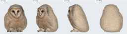

# Run379 — continuous neural mesh smoothing and physical down ribbons — ART_REJECTED / NO_RELEASE

2026-11-26 Shanghai. Parent 5de539e1ab4be0f9c018f657e25b90706b5c9806. Reviewed main owl-pet README/AGENTS/STATUS (206/251, 45 remaining), #172 v3 review and Run378. Target cream thick mesoptile, heart disc, buried short wings, concealed tail, supported feet; exact age unknown; science=false. No production changes or extra paid calls.

Recovered original official Hunyuan3D-2mini Turbo CPU output and pupil-restored input via Actions artifact 14599833411, Run233 (44668960253). Original GLB SHA256 0e6eedf3ff0b95269555c590c34e996fdc584986d2912f589d817c6ba3b6a02c; 137851 vertices, 275630 triangles. Viewed prior axial mesh sheet and input. Local trimesh/scipy/VTK/Xvfb available, Blender not found. This is recovered neural geometry, not new inference.

## Actual experiments
Two iterations, three native GLBs each, all six exported and reimported. Continuous surface smoothing via normalized mesh edge adjacency A: 100 steps of sm=.55*sm+.45*A@sm. Smoothstep masks protect front upper face and toes, emphasize lateral lower body. Variant 1 uses local smoothing side*k+.12*body, adds normal displacement for fullness (.025+.055*side+.025*smoothstep crown) and coherent Gaussian-filtered 96^3 noise amplitude .008/.016; rear depth compressed .18*body. Native vertex RGB from front reference sample and cream side/rear synthesis (216,193,166), normal-based transition. 18000 tapered bent 3D down ribbons, 5 vertices and 3 triangles per ribbon, barycentric surface sampling weighted by face area and body mask, lengths .012-.040, widths .0013-.0035. V1 renders show severe crust-like relief, not down.

V2 changes smoothing weights to max(side*k,.85*body), recalculates normals on smoothed mesh, reduces noise amplitude .0015/.003, and samples 30000 longer, narrower bent ribbons (.018-.060 length, .0009-.0022 half-width). Seeds 379, deterministic. The two base meshes are watertight; groom is intentionally open ribbon geometry. All six actual GLBs were reimported with vertex colors. V1 groom 227851 vertices/329630 triangles; V2 groom 287851/365630. V2 base depth range approximately -0.717 to +0.865 vs original -0.855 to +0.863; broadened silhouette. Actual 24 VTK Xvfb renders, 360x360, angles 0/45/90/180, camera +Y up, front +Z, orthographic 1.17 scale. Both 12-view sheets visually inspected. 

V2 grooming visibly improves fuzzy silhouette and avoids V1 crust artifacts. Still reject: wing groove too pronounced and adult-like, front disc projects, sideways pigment smear and head crown flattened, dark tan rather than cream, short ribbon hairs too sparse and bristly instead of fluffy branching down, toes not adequately covered, back plain and with residual bumps. 12MB groom also costly for mobile. No physical phone or new mobile WebGL test; art gate fails first. Do not present as released pet. Prefer truly juvenile silhouette reconstruction and continuous feather tract correction, followed by lower-poly groom and material validation; do not simply increase ribbon count.

## Evidence and hashes

Thumbnail 256x69, 2177 bytes, SHA256 d4a5f678efab03e93b685885ce6562af3ca7a18e158ff266a7a00099c84d4312.
V1 soft GLB a8074f0edadb23b5af77169c555b08a93254c71aca244a1211835d9e0baa9795
V1 down GLB d920b145b1b9fe734ec2b50bff4285e1b2797a69f0617f771f7b6f59320335a5
V1 groom GLB 971329321e7f3604ea41898de4797a2bac6d621d5d60a7cdb47b1604a01b4e50
V1 sheet f93c9db97c561173cd37c44290bc608fb6efc8d013ecb09380434a6acde11f2d
V2 soft GLB a2651a361d81cd94e633a7cf74998931182803d7f8a7b2f6e9d45f88c1c63fb6
V2 down GLB 0fe7c88b4a89b6e14b2b756db4d2b167438f4ab6c2c85cefd21a69207447fe36
V2 groom GLB f5bc4c27d5dbb8ed72438bff2cdb768636c6a81d9a2826e5d3db07ad13210abd
V2 sheet d78f547ba285f25d21b9235fcd6c3667e7635ec3cf1a1ac499748dee67fda4aa
V1 sculpt.py f70525398264e0f56e63443b2494e7872838be11448b1d20684b99114dbf44cb
V2 sculpt.py 441dba7f8be90909d8f82ae7e9b6c37acff10d9530bf2616f5355372c400c2d3
render.py a653890683d14528abf59802346e64ba280b25862eee9305d61045b512b81594

Full newly generated binaries, scripts and full renders local only in this invocation; remote archive includes report, algorithm parameters and actual thumbnail, not complete GLB. Original source recoverable via Actions retention. No main, concept, production, deployment, or automation changes. ART_REJECTED / NO_RELEASE.
