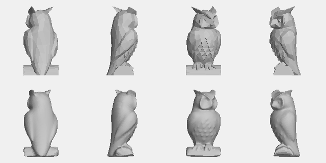

# Run429 — Loop subdivision art gate — NO_RELEASE

2026-11-28. Re-read main AGENTS, README, STATUS (207/251), #172 v3 dossier and actual mesoptile crop blob 2915b7c86316359ff2b8cbd26eb174bfa0280613. Read Run428 commit b3c30c348c39facf185989cbbd28cd7f7996a101. The target is the right v3 cream down-covered bird, broad tan-rimmed heart disc, dark eyes, horn bill, short wings concealed in down, concealed tail, large supported feet, unknown exact age. No main or production edits.

## Actual mesh experiment

GitHub exact extension search retrieved daergoth/subdivision-surface owl.obj, source blob c788f23e2b8f02dbaeccbe61a2f9f5ab232e50d0. https://github.com/daergoth/subdivision-surface/blob/master/owl.obj . Repository metadata declares MIT, but asset provenance is unclear (OBJ Assimp export references Owl_LowPoly.obj.mtl, absent in repository); no external source mesh is redistributed. The README's preview is a sphere subdivision demonstration, not the owl; actual mesh parsed and rendered separately.

Original 309 vertices, 614 triangles, 921 edges, zero non-two-face edges, zero out-of-range indices. Bounds x [-37.794,38.6835], y [-34.3752,35.0262], z [-0.0280768,151.15]. Applied two actual Loop subdivision iterations using standard interior midpoint weights (3/8 endpoints + 1/8 opposite vertices), vertex beta 3/16 for valence 3 otherwise 3/(8n). First 1230 vertices/2456 triangles; second 4914/9824. Same scale and orthographic rotation, four quarter-turn views with triangle depth-buffer rasterization and normal lighting, 160x160 each. Coverage original [7269,6055,7269,6055]; subdivided [6953,5801,6953,5801]. Actual grayscale evidence image linked below; top row original, bottom two iterations, columns back/side/front/side as visually identified. No textures/PBR; this is geometry-only QA. Subdivision reduced silhouette area ~4.3%, but smoothed a fundamentally unsuitable adult statue. It retains prominent ear tufts, circular face/strong brow, elongated tail/wings and a pedestal; no juvenile down or broad heart disc. Reject; no further refinement of this source.

## Other acquisition attempts

- jbaccam/roguelite pet-kit owl GLB blob 3fdf8ed6be9fc4983d39622ff26326df25b171cf and series-ai/jam-ready-assets barn_owl.glb blob 31943d2beccdf98550a505f1b150d032682c48e2 both fetched only Git LFS pointers. heleledd/cm3202-vr-zoo owl GLB response was empty. No usable model from these.
- New free baby owl sculpt listing https://www.cgtrader.com/free-3d-models/animal/bird/free-baby-owl-sculpt advertises 236060 polygons, 16.7MB OBJ, royalty-free no-AI license. Not retrieved, not qualified for AI workflow or redistribution; no account/payment used.
- https://sketchfab.com/3d-models/barn-owltyto-alba-af3cdd38e029430d9c131370ebf1bb33 lists CC BY 760 triangles, insufficient evidence of juvenile proportions. Museum CC0 adult barn owl scan https://sketchfab.com/3d-models/barn-owl-0e65de5934db4f0eae02835ba7227dcc lists 262k triangles, not juvenile verified. No model file retrieved from either.
- Local runtime probe: github.com, huggingface.co, api.sketchfab.com, muzea.malopolska.pl all DNS Errno -3; trimesh, torch, VTK, scipy, skimage available; Blender and bpy absent.

ART_REJECTED / NO_RELEASE. No high quality sample or mobile WebGL evidence. Zero paid calls. Prioritize genuine juvenile Tyto mesh or an original anatomical sculpt with appropriate license; subdivision cannot fix wrong genus/age. No changes to main, original images, 251-species production or deployment.
