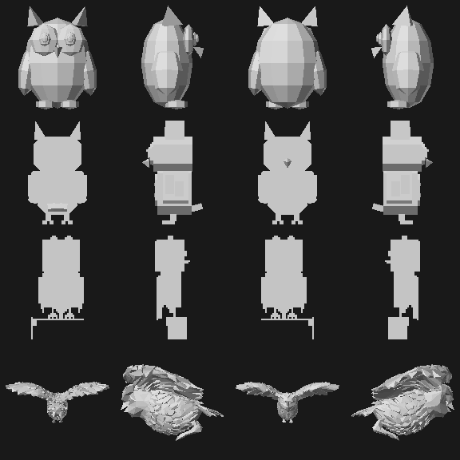

# Run430 — four native OBJ source art gates — NO_RELEASE

2026-11-28. Re-read main AGENTS, README, STATUS (207/251), #172 v3 dossier, and directly viewed the complete original mesoptile crop (blob 2915b7c86316359ff2b8cbd26eb174bfa0280613). Read Run429 at 304afb02fc100b284635e811acf46b5511ff8832. The target remains broad heart disc, dark eyes, cream down, compact crouch, hidden remiges and tail, supported feet; exact age unknown. No main/production edits.

## Actual geometry experiment

Retrieved four real OBJ text assets via GitHub, parsed vertex positions and fan-triangulated face records, rendered actual triangles with a software orthographic depth buffer, flat normal lighting, 144 x 144 pixels per view, four Y-axis rotations 0/90/180/270 degrees. Each view is fitted independently, not a comparative scale chart. No materials or textures applied. Absolute normal-light dot avoids black backfaces for diagnostic silhouette; it is not PBR. Source files not redistributed, licensing/provenance not verified for these four files, no adoption.

| Row | Source / immutable blob | Vertices | Triangles | Covered pixels (four views) |
|---|---|---:|---:|---|
| 1 | ther12k/colo-3d, art_source/luna_owl.obj, blob 032f7d6f491a81dc335d511bf2c6740d602382ca | 1956 | 652 | 8914 / 6264 / 8914 / 6264 |
| 2 | AthenaENV-PS2-GAMES/crossy-road-ps2, game/models/owl.obj, blob 79b83906f59020546e84a1bc296351a172677e75 | 365 | 582 | 6474 / 5560 / 6474 / 5560 |
| 3 | MartyChouette/Marty_Site_React, main/public/obj/owl.obj, blob 8d519277666482b05c75e5e7e656b9910e7f317e | 2414 | 1876 | 4974 / 3784 / 4974 / 3784 |
| 4 | bilawal-mahmood/AR-Unity-Educational-App, Assets/Owl_high.OBJ, blob 870725a164b65963f8f5f3f85d6494489b6572f1 | 2573 | 4206 | 2231 / 7001 / 2231 / 7001 |

Visually inspected the entire rendered sheet. Row 1 is a polygonal horned owl with circular eyes and conical ear tufts; row 2 blocky game owl; row 3 MagicaVoxel bird on branch; row 4 adult bird with extended wings, detailed adult feather surfaces, not a crouching downy juvenile. All four rejected at morphology gate. No subdivision or recolor of unsuitable base. No claim of actual mobile rendering or deployable pet. File counts refer to OBJ records, not welded unique vertices.

## Free rigged Tyto lead

Read https://vinish.dev/free-3d-models/birds : author advertises CC BY 4.0 barn owl, 52,276 triangles, 2.5 MB and folded-wing idle animation. Actual preview at https://vinish-models.pages.dev/birds/barn-owl.webp viewed; adult slender standing proportions, long folded wings and tail, exposed legs, no down, not the target. Tried https://vinish-models.pages.dev/birds/barn-owl.glb via web: 400 unsupported model/gltf-binary. Tried direct urllib download: URLError [Errno -3] Temporary failure in name resolution. No GLB received or animation verified. Mint adult barn owl lead already tried Run427, not counted as new. Runtime has trimesh, scipy, skimage, torch, VTK, chromium; Blender/bpy absent. Zero paid calls.

ART_REJECTED / NO_RELEASE. No qualified character sample. Next source gate should prioritize juvenile-specific morphology rather than generic adult or low-poly owls; no promotion of this diagnostic to release. No main, original concept, 251-species production or deployment changes.
