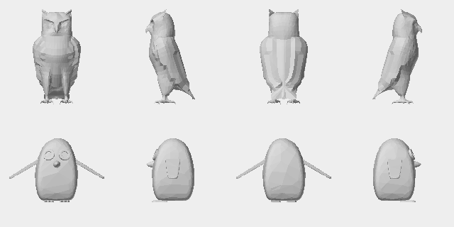

# Run431 — juvenile source integrity gate — NO_RELEASE

2026-11-28. Re-read main owl-pet AGENTS, README, STATUS (207/251), species/172-tyto-castanops-v3.md, Run430 at e28ad0e165a8260abd8349b7317568870d6ffbd0, and directly viewed original v3 PNG blob 5126b4bbc2d637aad4848b6c8a3825e7ef9bd05b. Target is the rightmost cream mesoptile (age unknown), dark eyes, broad warm-edged heart disc, compact supported feet, down-buried wing and concealed tail.

## Real source access and validity
Searched exact juvenile filenames owlet.obj, baby_owl.obj, babyowl.obj, owl_chick.obj and owlet.stl; all returned zero GitHub code hits. owlet.gltf gave unrelated Rowlet. Named BarnOwl.obj was the already-rejected Run427 blob, not a fresh candidate. Tried three other native OBJ files. Two passed finite position and valid integer index checks and were rendered as actual depth-tested triangles at 0/90/180/270-degree Y rotation, 160x160 each, fixed scale from each model's largest bound, grayscale flat-normal diagnostic, no material or PBR.

```json
[
  {
    "repo": "shape-vis/gasp",
    "path": "Data/Mesh/owl.obj",
    "sha": "448c1afc509b7bf664f28623b8420770524f6cd4",
    "vertices": 1698,
    "triangles": 3392,
    "bounds": [
      [
        -0.426045,
        -0.814869,
        -0.509932
      ],
      [
        0.426047,
        0.886281,
        0.366766
      ]
    ],
    "coverage": [
      6516,
      4606,
      6516,
      4606
    ]
  },
  {
    "repo": "cogcities/cognitive-architecture",
    "path": "city-model-example/Golden Triangle/BlenderObjects/owl.obj",
    "sha": "9f9141e0fb6c658b9549021ee8773d513a2f6c25",
    "vertices": 2273,
    "triangles": 4482,
    "bounds": [
      [
        -0.729167,
        0,
        -0.331949
      ],
      [
        0.729167,
        0.980515,
        0.41
      ]
    ],
    "coverage": [
      4905,
      4606,
      4905,
      4606
    ]
  }
]
```



Row 1 is an upright adult horned owl, elongated legs/body and tail, planar feathers; row 2 is a stylized egg-like cartoon with closed eyes and extended thin wings. Both art rejected. Source rights not independently verified; neither adopted nor redistributed. The diagnostic is not a pet or mobile test.

Third file anubhavaanand/planetwood public/assets/npcs/present/owl/owl.obj blob 803a53b0999998db8ffb9bce17f741f9a0e7150c: 963 v records, one nonfinite 'v 0 0 undefined'; all 1,132 f records have NaN position indices. Rejected at integrity gate, not a zero-coverage valid model. Initial contact sheet had a blank row from this malformed OBJ; regenerated evidence excludes it. Lost owl STL hackclub/bakebuild projects/lost-owl-f717f8d2.stl blob 835d1345781a60af846b5c5283d8206e3c8cf6cb only provided LFS pointer, no model bytes.

## Juvenile-specific free route
Meshy https://www.meshy.ai/tags/owlet actually opened: Sunlit Owlet and Barnaby Owlet listed; gallery states community CC0 subject to underlying third-party rights, and free account required for downloads. No actual candidate mesh downloaded, no account registration or paid calls. BlendSwap https://blendswap.com/3d/owl search index lists Baby Owl Character (CC BY), direct fetch 403; no file. CGTrader free baby owl sculpt https://www.cgtrader.com/free-3d-models/animal/bird/free-baby-owl-sculpt has no-AI license label; not used as generative input. Printables Barn Owl https://www.printables.com/model/1813515-barn-owl/files is CC BY-NC-ND, not a modifiable commercial base. Local probes: Blender/bpy absent, trimesh, VTK, scipy, playwright and chromium present, Torch 2.10.0+cpu, CUDA unavailable, DNS resolution fails for github.com, huggingface.co and blendswap.com. No new usable juvenile native model or checkpoint.

## Decision
ART_REJECTED / NO_RELEASE. No qualified model, no phone WebGL test. Future source screening must validate finite coordinates and index range before rasterization and prioritize juvenile-specific anatomy. Zero extra spend; no changes to main, 251-species production, original concept or deployment.