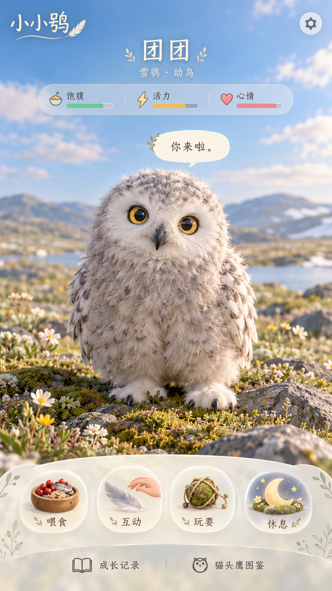

# 游戏主界面视觉原型

## home-v1 · 2026-10-10

状态：待用户确认的视觉稿，不是可操作界面或实际3D模型。雪鸮幼鳥仅为首屏探索角色，未最终选定游戏主宠物。

主交互：喂食、互动、玩耍、休息。次级入口：成长记录、猫头鹰图鉴。场景围绕开阔苔原，角色占主要空间。

## 待修正

- 喂食图标生成了混合水果食物，不能当作雪鸮真实食谱，需要更换适当肉食的游戏示意。
- 角色仍有轻微脸部侧倾，需要延续自然正姿规则。
- 幼鳥脸羽和翅羽阶段未校准，不标具体日龄。
- UI文字、间距和触摸区域须在代码中独立实现。
- 本图只用于视觉确认，不用一张图片冒充可旋转3D宠物。

## 交互规格草案

喂食提高饱腹；互动回应触摸并提升心情；玩耍提升心情并消耗精力；休息随时间恢复精力。状态本地保存，图鉴以学名连接物种档案。真实行为动画应以已核验的结构和观察资料设计。
