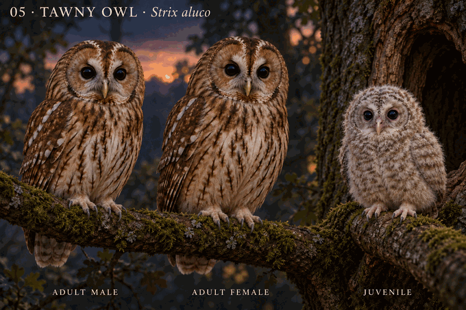
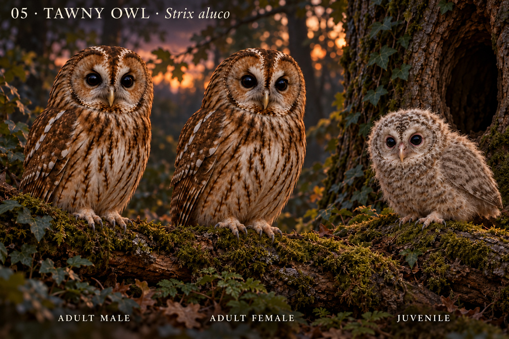

# 05 · 灰林鸮 Strix aluco

研究日期：2026-10-10。欧洲棕色型参考；未覆盖全部地域和色型。待用户确认。

## 特征与来源
圆面盘、深色眼睛、无明显耳羽簇，林地棕灰斑纹。色型存在灰型与棕型，不能直接用色型区分雌雄；本图两只成鸟统一选择棕型。
BTO活鸟测量：雌鸟翼长273.9±14.8mm（N=235），雄鸟259±7.4mm（N=54）；雌鸟体重502.2±58.6g（N=179），雄鸟396±44.6g（N=37）。均值差异不等于站立高度比例，个体测量存在重叠。
Barn Owl Trust救护观察：较小巢内雏鸟以短厚灰绒羽为主，较大雏鸟有松散灰白和棕米色波状纹；幼鸟暗眼、粉红眼睑边缘。极早幼鸟可有白绒羽，故不将所有幼态统一画灰。

## 本图设计选择
选择已睁眼、灰绒羽为主的巢内雏鸟，不标具体日龄。低伏腹部支撑，翅羽未成熟，无成人式尾羽。成年雌鸟略丰满；眼睛和面盘有动画化表达。注明“角色概念图 · 非测量比例”。

## 核查限制
初稿眼睛偏大、雏鸟翅部仍有可见羽片；粉红眼睑及灰绒羽方向符合所选参考，但具体日龄、体型比例、翅部成熟度未科学验收。棕型选择不代表物种全部色型。图像不可反证自然特征。

## 来源
- BTO：https://www.bto.org/learn/about-birds/birdfacts/tawny-owl
- Barn Owl Trust雏鸟比较：https://www.barnowltrust.org.uk/owl-facts-for-kids/tawny-barn-owl-owlets/
- Barn Owl Trust辨识：https://www.barnowltrust.org.uk/barn-owl-facts/owlet-identification-age/
- 2025原始研究，灰/棕型及色型评分：https://www.nature.com/articles/s42003-025-09365-1

## 概念图

生成规格：电影感3D动画角色、同地面视角、棕型成年雌雄、灰绒羽巢内雏鸟、暗眼、粉红幼鸟眼睑、无耳羽簇、自然头颈、非测量比例。使用内置imagegen生成。

## 2026-10-18 v2 实际修订与复查
肩翼灰绒修订；短厚灰绒方向改善，细羽纹/精确羽龄与比例仍未知。按imagegen技能实际编辑并查看，原图独立远端下载/完整解码/哈希通过，scientifically_verified=false。旧v1及其用户审美确认保留，不自动转移新版。
来源索引ID：TAO-BOT-OWLET / TAO-BTO-FACTS，本次实际读取范围与局限见SOURCE_INDEX及运行记录。概念图非测量比例。
[v2原图](../../design/concepts/05-strix-aluco-v2.png) · [完整提示、检查与提交](../../production/runs/2026-10-18T2230+0800-cycle-2.md) · 图片提交0ec35f2b5fe2e9afc2b2dd74edc2c2a0f987feaf。

## v3 labeled brancher revision · 2026-10-28

v3 uses one brown adult morph and an approximately 29–32-day pre-flight brancher based on Mikkola, BTO and Coles & Petty. One targeted edit removed long adult-spotted juvenile remiges. Exact age, continuous feather sequence, display ratio, regional morph and cavity geometry remain unknown; science false.

[Research](../../research/species/05-strix-aluco-v3.md) · [Run](../../production/runs/20261028T0743+0800-cycle-5.md)

## v4 recent-fledgling locomotion revision · 2026-10-30

V4 selects a first-week recent fledgling rather than a nestling. Two primary tracking studies support poor early locomotion and delayed near-full flight skill; Mikkola supports diffuse juvenile mesoptile. One targeted edit removed crisp adult-like wing spots/rows while retaining a formed folded wing, short incomplete tail, pinkish eye rims and complete low support. Exact day, sex, subspecies, wing/tail metrics, iris transition and first-flight threshold remain unknown; science false. V1 approval is preserved but not inherited.

[Research](../../research/species/05-strix-aluco-v4.md) · [Run](../../production/runs/20261030T0033+0800-cycle-1.md) · [Source index](../../research/SOURCE_INDEX.md)

Fixed-tree archive verification passed at `afa285df8c801b83605af9038a16a03ecd8fa45e` on 2026-10-30T00:55+08:00; all four image paths/blobs/sizes and supporting records matched. Scientific verification remains false.
