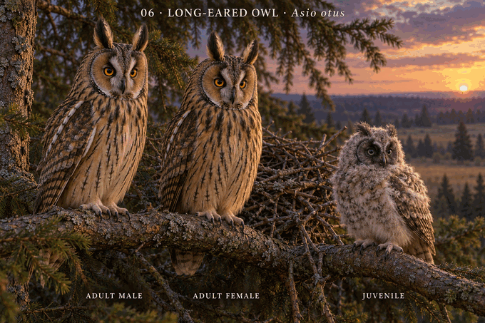

# 06 · 长耳鸮 Asio otus

研究日期：2026-10-10。成年参考欧洲橙眼型；幼鸟发育参考北美研究，地域对应尚未完整核验。待用户确认，科学核验未通过。

## 成年与体型事实
细长耳羽簇、橙色眼睛、栗棕面盘和隐蔽棕色斑纹。耳羽簇是羽毛结构。
BTO活鸟测量：雌鸟翼长300.2±7.6mm（N=81），雄鸟296.1±7.1mm（N=35）；体重雌鸟299.7±35.1g（N=76），雄鸟265.8±41.7g（N=33）。数据重叠，体重和翼长均不能换算为站立高度。图中成年尺寸接近，无虚构性别羽色。

## 幼鸟发育事实
Seidensticker等2006研究美国蒙大拿52只幼鸟、15巢：初生白绒羽，眼睛完全睁开平均6.4日；早期虹膜灰或暗绿。第二绒羽约两周替代第一绒羽，面盘自约14日加速发育，耳羽簇约19日明显。时间有个体差异，非通用精确日龄表。
所选幼态是睁眼后、明显面盘与耳羽簇形成前的巢内绒羽阶段，不在图上标日龄。低伏腹部受支撑，未成熟翅羽藏在绒羽下。
研究地区与欧洲成鸟参考不同，不将北美虹膜最终颜色直接套用欧洲成鸟。

## 设计与核查
修长成年体形、细长耳羽簇，与粗壮雕鸮区分；雏鸟无明显耳羽簇。树枝旧巢作为环境设计，长耳鸮常复用其他鸟旧巢；本图不是它亲自筑巢的示意。
图像已修正明显雄鸟更高的初始生成问题。雌雄脚下枝条仍不完全水平，不能作测量对照。幼鸟眼部、面盘、绒羽与足部比例仍有动画化表达，需地域对应照片继续校对。画面注明非测量比例。

## 来源
- BTO：https://www.bto.org/learn/about-birds/birdfacts/long-eared-owl
- Seidensticker等2006，Growth and Plumage Development of Nestling Long-Eared Owls，The Condor108:981–985，作者全文：https://tylerflockhart.com/wp-content/uploads/2016/06/1.Seidensticker_2006.pdf
- ORI长期研究：https://www.owlresearchinstitute.org/long-eared-owl-research

## 图像

生成规格：电影感3D动画角色、欧洲型橙眼与细长耳羽簇、成年雌雄尺寸接近、早期白绒羽巢内雏鸟、灰绿幼鸟虹膜、自然头颈与低伏姿态、非测量比例。内置imagegen生成并修正成年站姿。

## #06v2 archive
Actual built-in edit viewed: early chick tan structured disks removed, unstructured white down/graygreeniris retained, nest-supported lowbody and adults preserved visually. Reuse LEO-SEIDENSTICKER-2006 fresh pp982–983; exactage/feathermap/European-Montana correspondence and adultheight pending, sciencefalse. Prior approval v1 retained not transferred. Original2604774bytes SHA2561db9b61edaf27ee3bd643e93d1324ebab73a993c7eab4d764aa2cfb53fdedb8f Gitblobff9b55db488963b3c4f3be288114a4b01ed7c1f5. Remote download verification pending. Unique122/251 unchanged.

## v3 science-revision archive checkpoint (2026-10-28)

Replaced the older generic early-nestling layout with a labeled trio board bounded by Mikkola printed pp.504–506 and Seidensticker et al. 2006. The approximately 22-day brancher is post-nest-departure but preflight: diffuse second down, dark face, incomplete tufts, dark gray-green eyes, formed folded wing/tail, stable two-foot support and no flight pose. Adults remain comparable in display scale; female only subtly fuller. Full source and derivative were viewed; no edit was warranted. Exact day, iris transition, continuous feather sequence, display ratio, subspecies and nest geometry remain unknown; science false.

