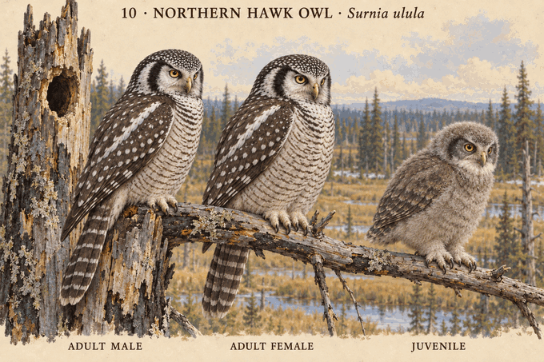

# 10 · 猛鸮 Surnia ulula

研究日期：2026-10-10。Northern Hawk Owl，又称北方鹰鸮；北美参考，未覆盖全部地域。用户确认本组概念造型（2026-10-10）；科学核验未通过。

## 来源事实
Cornell与NPS：中等体型、紧凑椭圆身体、短尖翅、明显长而收尖的尾；白或灰白面部有深色侧缘，黄眼黄喙，深色背部白斑，下体横纹，足部覆羽。两性羽色相近。
NPS阿拉斯加概述：雄鸟体长36–42cm、约300g，雌鸟37–44cm、约340g。体长含尾部，不等于站立高度；范围重叠。图中不据此指定高度百分比。
Cornell：初生无助、白绒羽；树洞、啄木鸟旧洞及断树中空顶部为主要巢位，通常不添加巢材。

## 设计选择
成年突出长尾、黑边白脸、细横纹，不画巨大面盘或耳羽簇；雌雄尺寸接近。幼态选早期巢内白绒羽、低伏腹部支撑，无成年长尾和面纹。闭眼是休息表情，不用来断言该物种某日龄眼睛尚未睁开。
右侧树洞为展示巢内雏鸟的艺术剖视；比例与洞穴几何未测量复原。图上注明非测量比例。

## 图像核查限制
成年身体偏圆，尾部应进一步核对渐尖形状、相对翼长与身体长度；成年白面边缘、眼睛比例和羽纹有动画化表达。幼鸟具体日龄、绒羽密度及喙色未科学核验；未得到对应阶段线性尺寸，不作为幼成比例标尺。图中底层碎木是环境设计，不表述为猛鸮主动搭建巢材。

## 来源
- Cornell识别：https://www.allaboutbirds.org/guide/Northern_Hawk_Owl/id
- Cornell生命周期：https://www.allaboutbirds.org/guide/Northern_Hawk_Owl/lifehistory
- NPS阿拉斯加资料：https://www.nps.gov/articles/northern-hawk-owl.htm
- 中文名对应：https://wiki.biodiversity.cern.ac.cn/index.php/猛鸮

## 图像

生成规格：电影感3D动画、紧凑身体与长横斑尾、白脸深色侧缘、黄眼黄喙、无耳羽簇、足部覆羽、树洞内早期白绒羽低伏雏鸟、非测量比例。内置imagegen生成。

## 2026-10-25 · v2 evidence-bounded rebuild

Freshly read sources NHO-CORNELL-ID-2026, NHO-CORNELL-LIFE-2026 and NHO-NPS-NEST-2021 were added to the central index. v2 restores the adult hawk-like silhouette: compact oval body, short pointed folded wing and conspicuously long tapered barred tail, while retaining yellow eyes, dark-bordered white face, feathered feet and near-equal displayed adult scale.

The early nestling is age-unknown: white natal down, closed/slit eyes, tiny down-buried wing buds, no adult facial border, mature remiges, barring or formed tail; belly and both feet are supported by the hollow snag floor. The first render passed visual review without edit. Exact age, eye-opening time, continuous feather sequence, measured proportions and quantified sex difference remain unknown; scientifically_verified: false. Historical v1 and its user-approved scope are preserved and not transferred to v2.

- Image: [10-surnia-ulula-v2.png](../../design/concepts/10-surnia-ulula-v2.png)
- Image commit: `1cb0e03314af160cbdd4ad91f50ce21a6811d18b`
- Git blob: `79de445a797eebb5d2c6b0eb2c84fec2d76618dc`
- SHA-256: `8cd274feb085837a97a5e38faeac055c964563239236eeed025e4f8627f156d4`
- Run: [2026-10-25T1932+0800-cycle-6.md](../../production/runs/2026-10-25T1932+0800-cycle-6.md)

## v3 science-revision archive checkpoint (2026-10-28)

Mikkola printed pp.360–363/PDF pp.362–365, E-Fauna BC and Huhtala et al. 1987 bound a recently nest-departed but preflight gray-mesoptile branch-clamberer with formed yet still modest wing/tail. One edit corrected the adult display direction and removed overly crisp juvenile wing spotting while retaining full branch support. Exact day, continuous feather sequence, flight threshold, ratio, subspecies and universal nest form remain unknown; science false.

