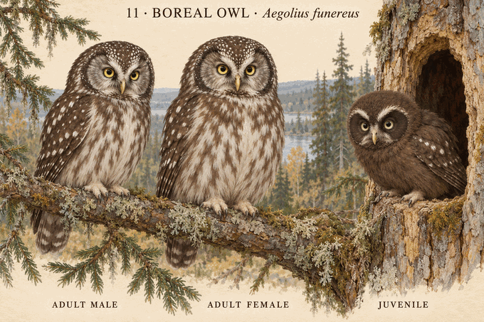

# 11 · 鬼鸮 Aegolius funereus

研究日期：2026-10-10。Boreal Owl / Tengmalm's Owl。跨北美与欧洲来源；并非特定亚种的测量复原。用户确认本组概念造型（2026-10-10）；科学核验未通过。

## 来源事实
Cornell识别：小型、方形大头、无耳羽簇、短尾、黄眼；灰白面盘有深色框，棕色背部白斑、冠部细白点、白腹棕色纵纹。合并两性体长21–28cm，不用于性别高度比例。
Alaska Fish and Game 1994概述：雌鸟平均179g、雄鸟106g，雌鸟较大；浅色喙、面盘上角近黑色。地区及年代特定数据，质量差不等于站立高度差。
2020 Scientific Reports芬兰长期研究：方法部分成年雄鸟平均翼长171.7mm、雌鸟178.9mm；研究背景约100g和150g为引用概述而非本研究新的样本均值。翼长不直接转换站高，亦不与阿拉斯加质量拼接成比例。
Cornell生命周期：孵化时白绒羽、闭眼；使用啄木鸟洞、自然树洞及巢箱。早期绒羽与后期深色幼羽是不同阶段，不能混画。

## 设计选择
成年人头部方圆而非球形，深框白脸、黄色虹膜、白腹纵纹；两性采用相近羽色，雌鸟略饱满，未指定百分比。
幼鸟选择初生白绒羽、闭眼、低伏且腹部支撑的巢内阶段，无成熟飞羽与斑点，未赋精确日龄。
树洞为展示巢内雏鸟的艺术剖视，碎木不表示主动筑巢。画面非测量比例。

## 核查限制
眼睛大小、面盘几何、绒羽密度和幼鸟喙色动画化；未获得与画面阶段对应的幼鸟线性测量，不作为幼成比例或日龄图谱。本图雌鸟略高略宽，方向符合来源但幅度未测量校准；幼鸟绒羽在暖光下偏米粉，白色基调仍需校对。科学核验保持未通过。

## 来源
- Cornell识别：https://www.allaboutbirds.org/guide/Boreal_Owl/id
- Cornell生命周期：https://www.allaboutbirds.org/guide/Boreal_Owl/lifehistory
- Alaska Fish and Game：https://www.adfg.alaska.gov/static/education/wns/boreal_owl.pdf
- 原始研究2020：https://www.nature.com/articles/s41598-020-77531-y

## 图像

内置imagegen生成。生成规格：电影感3D动画角色表、方圆大头、无耳羽簇、深框灰白脸、黄眼浅喙、棕背白点白腹纵纹、接近尺寸成年雌雄、树洞剖视内初生白绒羽闭眼低伏幼鸟、非测量比例。

## v2 early down correction

## IMAGE_GENERATED / REVIEWED 2026-10-18T08:43:48.623Z
exec-4cd6d15f-a110-4b3e-a9a0-1a1bbad0d926 actualviewed50swait. Youngthinwhitewisps nowshowpinkhead/shoulderpatches; lowbelly supportedwooddust withcheek/neckmound, slightopenbeaknotlimp, closedeyes, tuckedtoes. Noformedwings/tail. Adultfaces/eyes/feathers/feet/scale andlabels visuallyretained notpixelidentity. Broadbookearlystage notknownexactday; degreeofpink/featherdensity andanatomy stillpending. Sourceagecapabilityguard: no24–34dayentranceperch appliedtoearlyyoung. No sciencepass/userapprovaltransfer.
## ARCHIVED pendingverification
PNG2642361bytes1536x1024 SHA256e8a3637d274582df0fd94e3bd571f0aaf2c91a2537580cf3af73cbd8e46fe95c Gitblob43dbe95ed1fc07e55f3bc51a4d51577f384fdfc7 copiedworkspace11-aegolius-funereus-v2.png. Unique130/251 unchanged.

Sources BOR-MIK2013-440, BOR-KOUBA-2014 at research/SOURCE_INDEX.md; original v1 and approval preserved, no pass transferred.

## v3 science-revision archive checkpoint (2026-10-28)

PLOS 2015 bounds fledging at 27–38 days and confirms incomplete wing growth; PLOS 2014 bounds entrance perching/climbing; Mikkola printed pp.440–443 and Korpimäki & Hakkarainen 2012 support a dark-chocolate, sooty-faced, white-browed late juvenile with a few scapular/wing-coverts spots. The approx. 30–33-day cavity-edge/recent fledgling passed first render; no edit was warranted. Exact day, continuous feather map, ratio, subspecies and cavity/box geometry remain unknown; science false.

Commit-pinned readback at `67e4d89e8844d95bd7192e275ab59e7d9d36b148` verified concept `72c5fd4fa69abfa35ee7ba20ce977b46186e97a4`, generated/reviewed master `da719433590ba4e65445eecb69a0937509237f36`, manifest and records. Science remains false.
