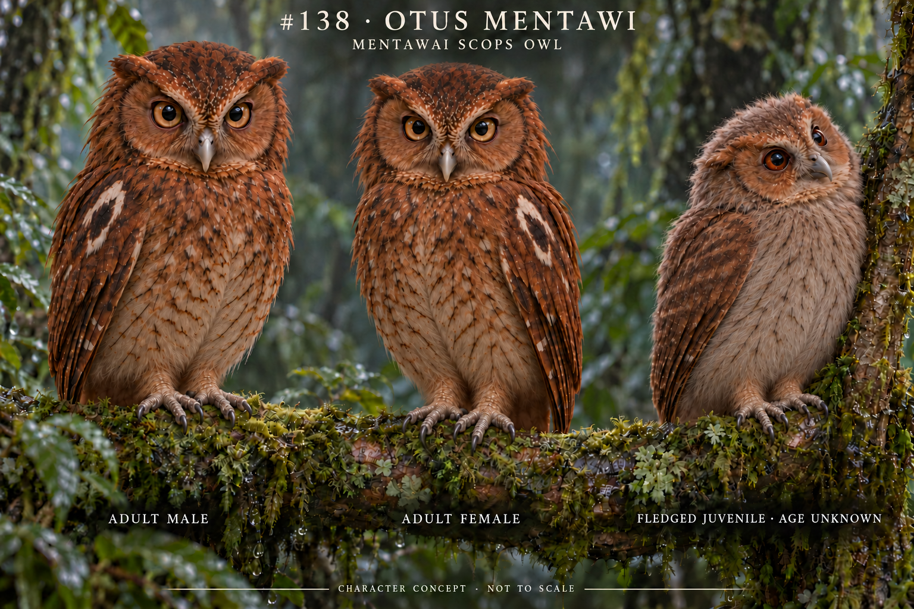
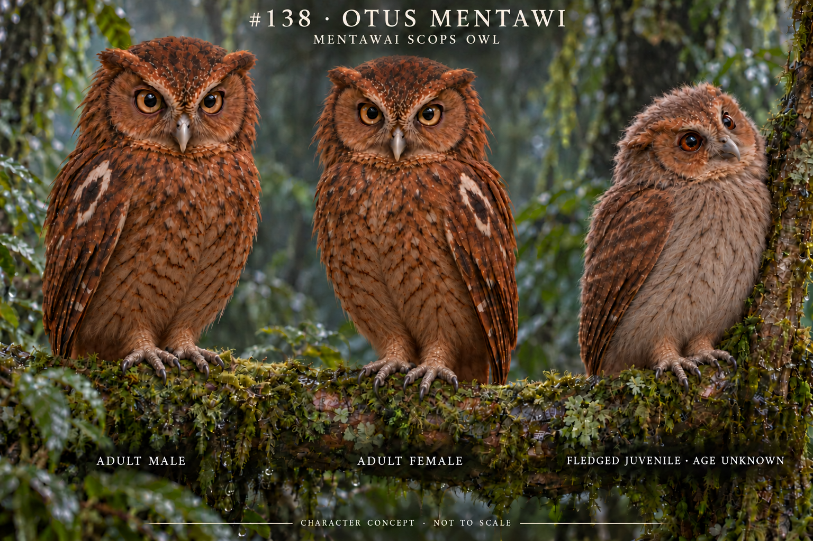

# Otus mentawi / 138-otus-mentawi

Sources and exact prompt: [run](../../production/runs/2026-10-19T0025+0800-cycle-6.md), [source index](../../research/SOURCE_INDEX.md).
Actual final edit2 viewed: adult gray scaly vertical tarsal shafts replaced with buffbrown feather cuffs to toe bases, baregraytoes/darkclaws/grips retained. Edit1 reduced juvenile boldwhiteocelli/strongfishbones to palergraybrown fluffy chest/thin diffuse shafts and subdued wingmarks; formed foldedwings retained. Adultbellies only modestly warmer, stillverypale and need palettecalibration. Short juveniletail largelyoccluded so wingtip/tailprojection cannot be fully verified; unknown dayage and adultsexualstandingratio. Brownirises/grayhornbills/subduedtufts/mottledchestnutadult retained. No claim all finefeathermap correct or scientificpass. Newthree sources indexed, completeprompt/edit history inrun.

Scientific verification: false. Adult sexual standing ratio unknown; near-equal display is design, not measurement. Exact juvenile day age unknown.

## 138-otus-mentawi-v2 2026-10-18T20:34:06.411Z
Actuallyviewed edited fullPNG: adultlowerbellies now visibly warmer brown/buff instead oflargeivorypatch, subtlepalergradient retained; juvenile palegraybrown/headtilt/formedwings and adultbrownirises/graybills/feathercuffs/baregraytoes/darkclaws/branchgrips preserved visually. Exactpalette/feathermap and occludedjuveniletail remainunknown; no scientificpass, oldapprovalnottransferred.

[Prompt/review](../../production/runs/2026-10-19T0431+0800-cycle-1.md)

## 138-otus-mentawi-v3 2026-10-31

Research-backed science revision preserving v1–v2. Adult gray bills were corrected to yellowish horn; both adults remain near-equal because no sex-size direction is documented. The age-unknown juvenile uses the 18–21 May 2017 field description: slightly smaller, pale greyish-brown and thin-streaked below, darker above, reddish-brown face/eyes, pale greyish-horn bill/toes, and formed folded wings projecting beyond a short dark tail. Full image and juvenile/adult-size-feet crops were viewed at original resolution. No edit was needed after review.

Reusable rule actually applied and visually validated: when a primary juvenile source gives a wing-to-tail relation, prompt and crop-review that relation explicitly rather than hiding the tail or replacing the young with a generic miniature adult. This rule is validated here only for #138 v3, not generalized to all owls.

Unknown: exact day age, independent flight ability, sex-specific standing ratio and complete feather chronology. Review result PASS_WITH_LIMITATIONS; scientific verification remains false.

[Research](../../research/species/138-otus-mentawi-v3.md) · [Run](../../production/runs/20261031T203540+0800-cycle-6.md)

## 2026-11-07 — v4 truncation repair / juvenile evidence revision

v4 preserves v1–v3 and replaces the repeated 700,000-byte v3 archive-risk image with a fresh complete render. The initial v4 juvenile inverted the field-record wing/tail relation. Two targeted edits removed the long tail and retained only a subtle short dark tail fringe beneath a longer folded wing. Full image and juvenile/adult crops were opened. Result: PASS_WITH_LIMITATIONS; exact age, flight competence, population sexual-size relation and a fully unobscured wing-tip/tail-tip comparison remain unknown. Scientific status remains false. See [research](../../research/species/138-otus-mentawi-v4.md) and [review](../../research/reviews/138-otus-mentawi-v4-review.md).
