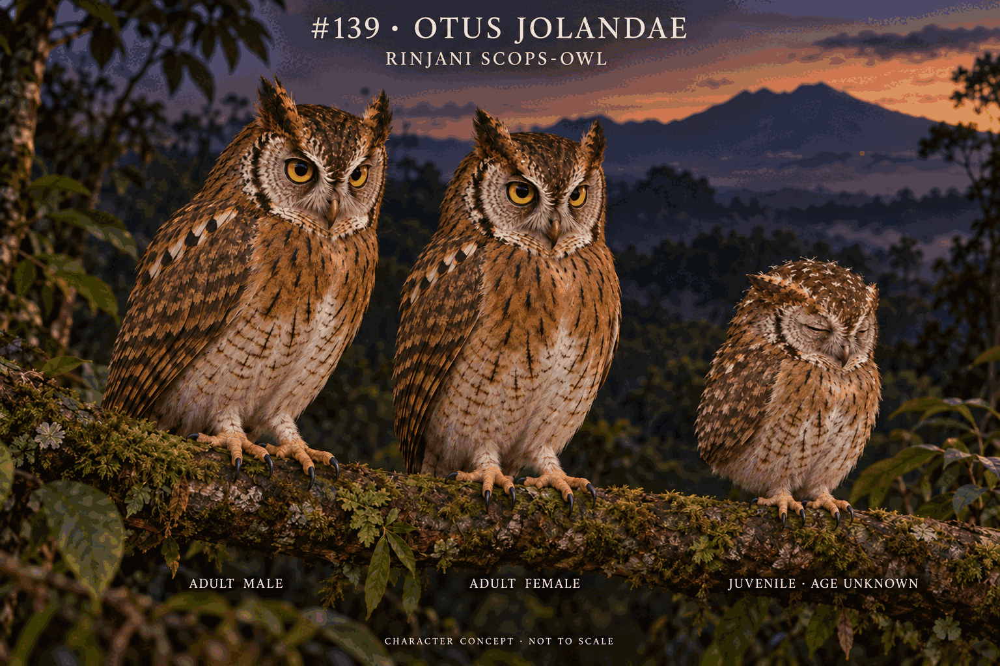

# 139-otus-jolandae

## 139-otus-jolandae-v1 2026-10-18T20:38:15.831Z
Actuallyviewed finaledit: broadarcs reduced to thinner morebroken darkbars andslendershafts, juvenilepale cap reduced to scatteredremnants. Threebirds/labels/adultgoldirises/brownbills/faceborder/warmercinnamonbreast-palerbellycontrast/formedwings/feathered tarsi reachingtoebase/bareochretoes/darkclaws and supportedrest maintained. No exactstandingscale/dayage, youngirisunknownclosedrestdesign; finefeatherdensity/colors stillunvalidated, sciencefalse. Uploadedbookfindresolvedtitleandcontentsp188butactualPDFpage190read403, nobookbodyused.

[Prompt/review](../../production/runs/2026-10-19T0431+0800-cycle-2.md)

## 139-otus-jolandae-v2 2026-10-27T10:58:00.000+08:00

Actual v1 and v2 viewed. v2 repairs the blank lower third, cropped unsupported birds and absent role labels; one targeted edit reduces repeated adult wing white to a compact black-tipped scapular row and shortens/softens the closed-eye age-unknown older immature wing. Adults retain golden irises, brown bills, dark-cinnamon upperparts, warm-cinnamon breast/whitish barred belly contrast, tarsal feathering to toe bases and natural branch support. Exact immature age/iris/flight, nest, sex ratio and fine pattern geometry remain unknown; science false.

[Research/prompt/review](../../production/runs/2026-10-27T0728+0800-cycle-6.md)
