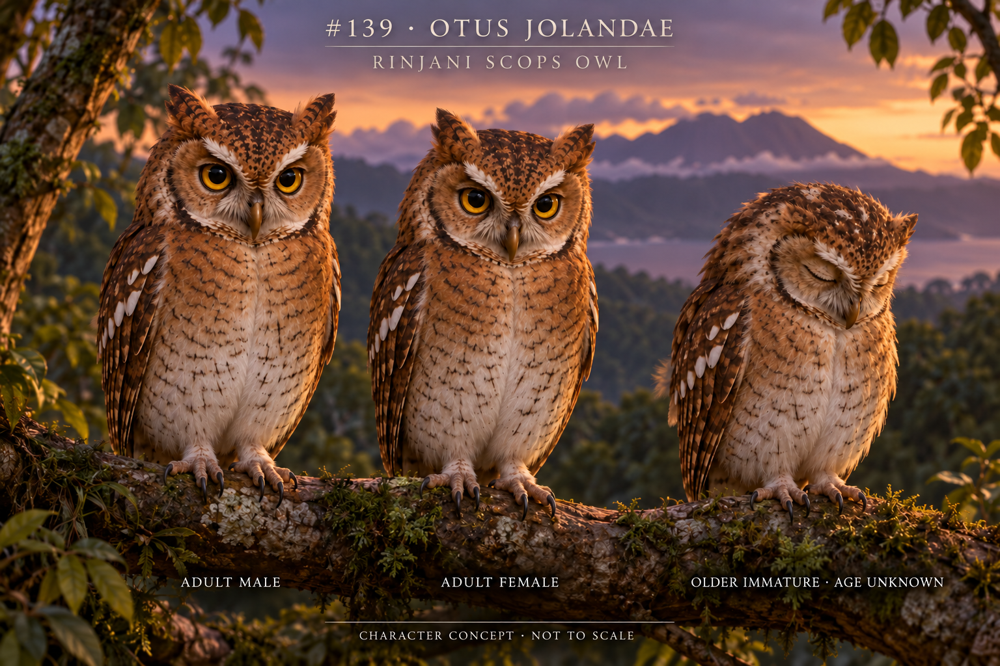
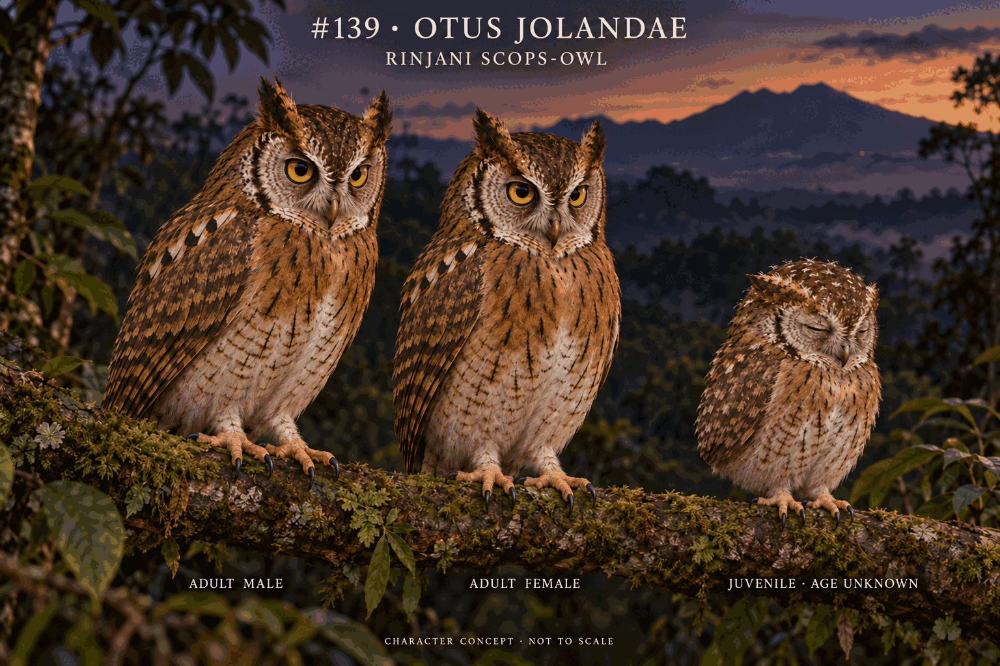
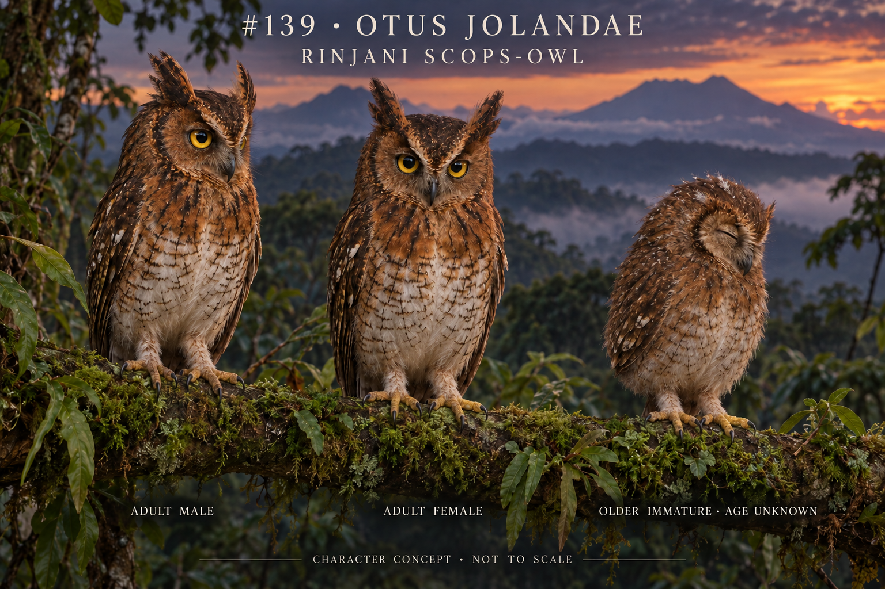

# 139-otus-jolandae

## 139-otus-jolandae-v1 2026-10-18T20:38:15.831Z
Actuallyviewed finaledit: broadarcs reduced to thinner morebroken darkbars andslendershafts, juvenilepale cap reduced to scatteredremnants. Threebirds/labels/adultgoldirises/brownbills/faceborder/warmercinnamonbreast-palerbellycontrast/formedwings/feathered tarsi reachingtoebase/bareochretoes/darkclaws and supportedrest maintained. No exactstandingscale/dayage, youngirisunknownclosedrestdesign; finefeatherdensity/colors stillunvalidated, sciencefalse. Uploadedbookfindresolvedtitleandcontentsp188butactualPDFpage190read403, nobookbodyused.

[Prompt/review](../../production/runs/2026-10-19T0431+0800-cycle-2.md)

## 139-otus-jolandae-v2 2026-10-27T10:58:00.000+08:00

Actual v1 and v2 viewed. v2 repairs the blank lower third, cropped unsupported birds and absent role labels; one targeted edit reduces repeated adult wing white to a compact black-tipped scapular row and shortens/softens the closed-eye age-unknown older immature wing. Adults retain golden irises, brown bills, dark-cinnamon upperparts, warm-cinnamon breast/whitish barred belly contrast, tarsal feathering to toe bases and natural branch support. Exact immature age/iris/flight, nest, sex ratio and fine pattern geometry remain unknown; science false.

[Research/prompt/review](../../production/runs/2026-10-27T0728+0800-cycle-6.md)

## 139-otus-jolandae-v3 2026-10-31T21:34:00+08:00

Problem → evidence → change → recheck: v2 had over-pale facial disks, regular large wing marks and a miniature-adult young bird. Sangster et al. 2013 pp.8–11 and Mikkola printed p.188/PDF p.190 constrain darker cinnamon adults, smaller pale coverts, no sex-size rule and only scattered retained crown/nape juvenile feathers in one otherwise near-adult specimen. V3 keeps adults near equal but changes posture, narrows pale marks and uses a supported age-unknown older immature. One targeted edit shortened/softened the young wing. Full 1536×1024 plate plus juvenile and adult-feet crops reopened: PASS_WITH_LIMITATIONS; exact age, iris, flight, nest and continuous feather sequence unknown; science false.

[Research](../../research/species/139-otus-jolandae-v3.md) · [Run](../../production/runs/20261031T212811+0800-cycle-1.md)

Reusable rule (applied and visually verified here, scoped): when evidence is an otherwise near-adult specimen with scattered retained juvenile crown/nape feathers, do not convert it to a downy chick or copy a full mature wing; use formed but shortened/softened remiges and keep exact age/ability unknown.
