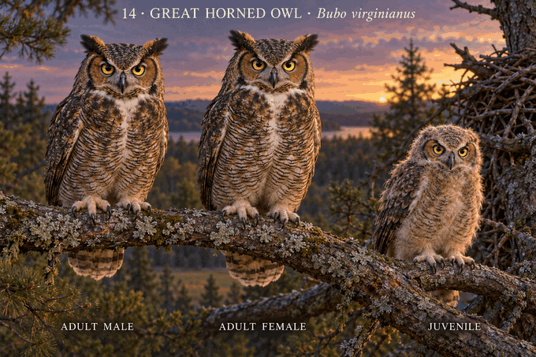

# 14 · 大角鸮 Bubo virginianus

研究日期：2026-10-11。Great Horned Owl。北美灰褐与肉桂面型设计方向，不涵盖全部地域；中文名称待版本化名录统一。造型待用户确认，科学核验未通过。

## 来源事实
Cornell：大型、粗壮，明显头顶耳羽簇、宽圆翅、黄眼；灰褐斑驳、灰至肉桂面盘、白色喉斑。区域色泽变化显著，不能把不同地域羽色当作性别差异。合并两性体长46–63cm、910–2500g。
ORI成年两性羽色相同；概述雄1304g雌1509g，页面身高雄51雌60cm，未列样本量和测量定义，不用于精确站高比例。成年仅表达雌鸟略饱满较大。
Cornell生命周期：树上旧猛禽或其他鸟兽巢常见，也用树洞等。初生闭眼、粉红皮肤、上体白绒羽。
Cornell Bird Cams FAQ：第一天及刚孵化前几天不能抬头；早期会张嘴和吞咽。第二套幼羽随后出现，三周耳羽簇可见小片。不能把后期黄眼、耳簇和成年飞羽混入初生白绒羽。

## 设计选择
成年宽耳簇黄眼白喉斑、灰褐背与细横斑腹，不复用雕鸮橙眼纵纹模板；两性同色同基线且尺寸接近。
幼鸟选早期巢内白绒羽阶段、腹部支撑，轻微抬头有巢缘支撑、嘴略张的表情；不标第一天或精确日龄，姿态仍是设计推演，不作为日龄参考。
树林旧枝巢与成鸟树枝统一环境；概念表并置非野外家庭瞬间。幼成大小非测量比例。

## 待核验
图中成年耳簇较大、目光偏严肃，腹部横纹排列过于规整；雌鸟高度略高方向合理但幅度未测量校准。幼鸟头抬得较高，需进一步核对早期发育能力，不视为初生第一天表现。白喉斑与横纹位置、耳羽簇方向和成年眼睛比例需校对；幼鸟抬头能力、绒羽覆盖、张嘴姿态与尺寸仍待来源照片/阶段数据验证。审美确认不等于科学验收。

## 来源
- Cornell识别：https://www.allaboutbirds.org/guide/Great_Horned_Owl/id
- Cornell生命周期：https://www.allaboutbirds.org/guide/Great_Horned_Owl/lifehistory
- Cornell巢直播FAQ：https://www.allaboutbirds.org/news/bird-cams-faq-great-horned-owl-nest/
- ORI：https://www.owlresearchinstitute.org/great-horned-owl

## 图像

内置imagegen生成。生成规格：电影感3D动画、宽头明显斜向耳羽簇、黄眼暗喙白喉斑、灰褐斑驳背和细横纹腹、接近尺寸雌雄、树林旧枝巢中受支撑白绒羽微张嘴幼鸟、非测量比例。

## 2026-10-11用户确认

本组造型获确认；科学核验仍未通过。用户要求后续幼鸟动作多样化，必须先核对物种与阶段能力，不机械套用乞食或坐立。

## v2 证据边界重建 · 2026-10-25

保留v1及用户造型确认，不覆盖原图；确认不自动迁移。重新读取Cornell识别、生活史和巢直播FAQ，采用同一地域灰褐成鸟形态、黄眼、深喙、显著耳羽和白喉斑；雌鸟仅略丰满，不把平均体重差换算为夸张站高。幼鸟采用闭眼、粉红皮肤、上体白绒的无助早期阶段，低伏并由旧枝巢支撑，无成熟翼尾与耳羽。实际查看通过，精确日龄、连续羽序、量化性别比例和巢几何仍未知，保持科学状态false。

研究、提示词与复查见 [cycle 3](../../production/runs/2026-10-25T2144+0800-cycle-3.md)。

## v3 labeled brancher revision · 2026-10-28

v1 user confirmation and v2 early-hatchling concept remain historical records; confirmation does not automatically transfer. v3 uses an evidence-bounded approximately six-week brancher with pale buff fluffy mesoptile, developed dark facial margin, reduced tufts, substantially grown folded wing, shorter unfinished tail and two-foot branch support. Adults share one neutral gray-brown morph; female is only subtly fuller because Mikkola states plumage is identical and individual/regional colour varies. Exact juvenile day, continuous feather sequence, quantified sex-size ratio, regional morph and universal nest geometry remain unknown. Scientific verification remains false.

Research and full prompt: [v3 card](../../research/species/14-bubo-virginianus-v3.md). Production record: [cycle 4](../../production/runs/20261028T0733+0800-cycle-4.md).
