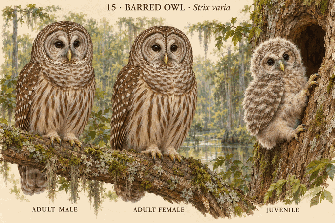
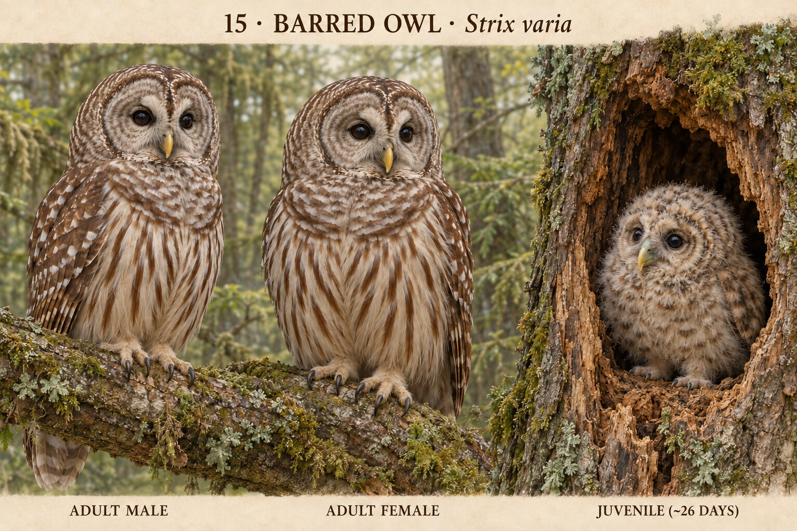

# 15 · 横斑林鸮 Strix varia

研究日期：2026-10-11。Barred Owl，北美方向，中文名待分类名录统一。造型待确认，科学核验未通过。

## 来源事实
Cornell识别：圆头无耳羽簇、深褐近黑眼；上胸褐横纹、白腹褐纵纹，中等圆尾。两性合并体长43–50cm、470–1050g。FAQ两性羽色相近，雌鸟更重，重至多三分之一不是站高大三分之一。典型树洞巢位。
Cornell后期幼鸟照片为灰绒羽有褐纹，不能把该阶段当初生白绒羽。没有年龄图谱时不赋精确日龄。墨西哥Strix sartorii已分出，旧广义范围不能直接套入现行目录。

## 设计与姿态
按用户要求丰富幼鸟姿态：选择白绒羽、闭嘴、腹部受支撑、侧蜷且头靠巢缘休息，非统一闭眼乞食。该姿态为设计推演，不声称某日龄观察，未获得对应幼成线性比例。
成年同地域同羽色、尺寸接近。图中雄鸟站高略高且脚下基线不同，大小表达未校准；幼鸟上身略高，需进一步验证支撑及发育能力。科学核验仍未通过。
1964发育论文全文读取失败，不据片段生成动作数据。未采用缺少本阶段证据的伸翅/走动。后续每个物种先核对动作能力再设计，避免泛化。

## 来源
- https://www.allaboutbirds.org/guide/Barred_Owl/id
- https://www.allaboutbirds.org/guide/Barred_Owl/lifehistory
- https://www.allaboutbirds.org/news/bird-cams-faq-barred-owl-nest/
- 全文未读：https://sora.unm.edu/sites/default/files/journals/wilson/v076n01/p0028-p0036.pdf

## 图像

内置imagegen生成：电影感3D动画、圆头深褐眼胸横腹纵纹、成年雌雄、树洞内白绒羽侧蜷靠巢缘休息幼鸟，非测量比例。

## 用户反馈 · 2026-10-11
用户回复“好，下一组”，确认v1本组概念造型；科学细节、大小表达与幼鸟支撑仍待核验。

## 2026-10-18 v2 实际修订与复查
成年落脚基线拉平，左头顶仍微高因姿态；不是性别比例科学验收，幼鸟支撑仍待核验。按imagegen技能实际编辑并查看，原图独立远端下载/完整解码/哈希通过，scientifically_verified=false。旧v1及其用户审美确认保留，不自动转移新版。
来源索引ID：BARO-CORNELL-FAQ-2020 / BARO-CORNELL-ID，本次实际读取范围与局限见SOURCE_INDEX及运行记录。概念图非测量比例。
[v2原图](../../design/concepts/15-strix-varia-v2.png) · [完整提示、检查与提交](../../production/runs/2026-10-18T2230+0800-cycle-6.md) · 图片提交af934406f09361fed47e85497f6bd66d7ce07727。

## v4 brancher/climber revision · 2026-10-28

Uploaded Mikkola printed p.29/PDF31 and pp.346–347/PDF348–349, the 2024 Canadian Field-Naturalist primary cavity-camera abstract, USFS 1997 climbing passage and Cornell cam material were actually read. v4 selects an approximately 30–33-day cavity-edge/brancher: fluffy brownish-white mesoptile, no adult concentric facial rings, alert dark eyes, bill/talons contacting rough bark, and full support. One targeted edit removed the first render's long adult-spotted wing and long tail while retaining the climbing action.

Adults remain untufted, dark-eyed and yellow-billed with upper-breast crossbars/lower vertical streaks; female only subtly fuller. Exact age, continuous feather sequence, flight threshold, sex-size ratio, regional variation and cavity geometry remain unknown. `scientifically_verified=false`; v1 approval remains historical.

[Research/full prompt](../../research/species/15-strix-varia-v4.md) · [run](../../production/runs/20261028T0840+0800-cycle-5.md)

## v5 direct cavity-entrance revision · 2026-10-30

The 2024 *Canadian Field-Naturalist* natural-cavity camera study and its supplement were actually read. Supplement Figure S2 shows nestlings at/peering from the entrance, while Table S6 bounds the earliest 2016 entrance record to an estimated oldest age of about 26 days and the last record to a youngest age of about 27 days. V5 therefore narrows v4’s generic external brancher/climber to an approximately 26-day bird wholly inside the cavity threshold with chest/belly and both feet supported; no bill-climbing or flight claim.

The first render contained a crisp adult-like white-tipped juvenile covert row. One targeted imagegen edit shortened and softened the wing into diffuse down-integrated mottling; the full 1536×1024 plate and 560×700 crop were reopened. Adult identity, exact count/text and cavity support pass. The study is one cavity/two seasons and ages are estimated; exact feather map and universal timing remain unknown. `scientifically_verified=false`; v1 approval remains historical and is not transferred.

[Research/full prompt](../../research/species/15-strix-varia-v5.md) · [run](../../production/runs/20261030T030200+0800-cycle-4.md)
