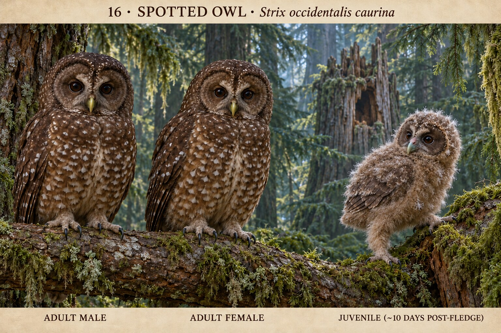

# 16 · 斑点林鸮 Strix occidentalis
研究日期：2026-10-11（Asia/Shanghai）。选择北方亚种 S. o. caurina；中文名与完整名录版本待统一。概念图待用户确认，科学核验未通过。

## 来源事实
- Cornell ID：圆头无耳羽簇，宽圆翼、短尾；整体深褐、胸腹椭圆白斑，褐色面盘，眼间浅色X，褐眼。北方型更深、白斑较小，不能混用墨西哥型浅面盘。
- Cornell合并两性体长47–48cm、体重500–700g；不推导雌雄站高或幼成线性比例。
- ORI：雌雄同羽色，雌鸟略大、较重；喙黄绿色。其两性“height”相同范围，且无样本与测量定义；仅采用性差方向。ORI的浅褐横纹young描述不用于初生白绒羽。
- Cornell生活史：巢可在树洞、断顶、旧巢等；雌鸟在现有碎屑上刮浅凹，至多添少量羽毛，不编草篮。初生无助、闭眼、白绒羽；巢内34–36天。
- Peregrine Fund：白绒羽闭眼，完全依赖亲鸟；约5周才出巢攀枝，不能赋给初生幼鸟。未采用其页面旧保护数量或法律状态。

## 设计选择与限制
选择成年雄鸟、成年雌鸟、巢内早期白绒羽幼鸟。同地域同羽色，成年人脚下基线相同、雌鸟仅稍丰满，不制造明显性别羽色差。
幼鸟三分之四侧后视、腹部受支撑、头低且轻转向观察者、喙略张，折叠翼芽贴身。此为保守姿态设计推演，尚无本亚种对应日龄动作记录，不能标为实证观察；不指定精确日龄。不得混入攀枝、跳跃、成熟飞羽或直立能力。
幼成大小为艺术排版，尚无匹配发育阶段的线性测量。确认造型不等于比例科学验收。

## 来源
1. https://www.allaboutbirds.org/guide/Spotted_Owl/id
2. https://www.allaboutbirds.org/guide/Spotted_Owl/lifehistory
3. https://www.owlresearchinstitute.org/spotted-owl
4. https://peregrinefund.org/explore-raptors-species/owls/spotted-owl

## 版本与待办
v1待用户确认。核对输出胸腹为白斑、无耳簇、暗眼、成年站高与脚下基线、幼鸟支撑和翼羽成熟度；继续寻找早期巢内动作视频/年龄图谱与阶段体型数据。

## 新增原始发育研究
Forsman, Meslow & Wight (1984), Distribution and Biology of the Spotted Owl in Oregon, Wildlife Monographs 87，印刷页36–37，PDF第34–35页：初生纯白绒羽闭眼，5–9天开眼之前相对不活跃；10–20天背、翼、头顶开始换浅褐横纹幼羽，此时开始巢内坐直、活动增多。与闭眼白绒羽方向相符，不能把此阶段画成坐直的成熟幼鸟。具体转头与张嘴仍属于设计推演，原文未给相应动作的精确最早日龄。
https://andrewsforest.oregonstate.edu/pubs/pdf/pub1762.pdf
另有Tufts约第一周照片待图像比较，质量/年龄标签不代替测量：https://sites.tufts.edu/babybirds/bird/spotted-owl/

## 输出检查与修订
v1雄鸟比雌鸟高，幼鸟偏坐直，未通过内部检查，保留历史图。v2缩小雄鸟并降低幼鸟胸、头，腹部低伏支撑，闭眼白绒羽，无成熟飞羽；成年尺寸方向改善。雌鸟仍显著大于雄鸟，画面头身高度差未校准为同亚种测量；幼鸟具体年龄、转头/张嘴能力和幼成线性大小仍待核验。v2为本次提交用户确认版本，不标记科学通过。

## 用户反馈 · 2026-10-11
用户回复“好。下一组”，确认v2本组概念造型；科学细节与比例未验收。

## 2026-10-27 v3 RESEARCH_READY

保留 v1–v2 与 v2 用户确认，不转移确认状态。新读 Forsman 等 1984 原始野外专著印刷 pp.36–37/PDF pp.33–34、USFWS 2012 调查规程印刷 p.33/PDF p.32 及 Cornell 北方亚种识别。v3 改用正常离巢但弱飞的幼鸟阶段：浅褐横纹中绒羽主导，翼羽仅部分发育，头/胸保留软绒；低伏抓握粗糙树干，可用翼/喙辅助，不画成飞行或由亲鸟搬运。精确个体日龄、连续羽序、线性比例仍未知，scientifically_verified=false。

来源索引：NSO-FORSMAN-1984-P36-37、NSO-USFWS-PROTOCOL-2012-P33、NSO-CORNELL-ID-2026。完整提示与阶段证据见 [cycle 6 run](../../production/runs/2026-10-27T1836+0800-cycle-6.md)。

## v4 ten-day post-fledge revision · 2026-10-30

Forsman’s 1976 Oregon State thesis was newly read at printed p.79/PDF p.109 Figure 8 and printed pp.82–83/PDF pp.112–113 Table 15. The directly captioned ten-day post-fledge bird was approximately 42–46 days old; the table describes fuzzy buff-brown mesoptile with natal-down tips, completing head/wing-covert mesoptiles, a small dark facial disk, dark-brown iris, pale watery-blue pupil, greenish-blue bill and pink cere. V4 selects this supported later stage rather than repeating v3’s generic nest-departure climber.

The first render leaked a long complete adult-like wing and tail. One targeted imagegen edit shortened the developing remiges to end above the rump and hid/shortened the tail while preserving the two-foot sideways sidestep. Full plate and 560×700 crop were reopened. Exact age remains approximate and individual remex metrics are unavailable; `scientifically_verified=false`. V2 approval remains historical.

[Research/full prompt](../../research/species/16-strix-occidentalis-v4.md) · [run](../../production/runs/20261030T031600+0800-cycle-5.md)
