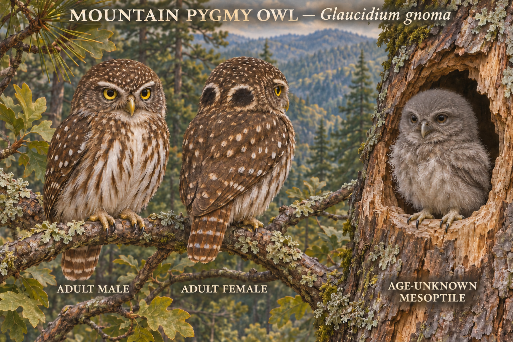
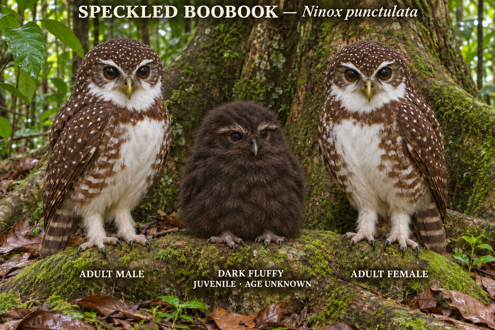
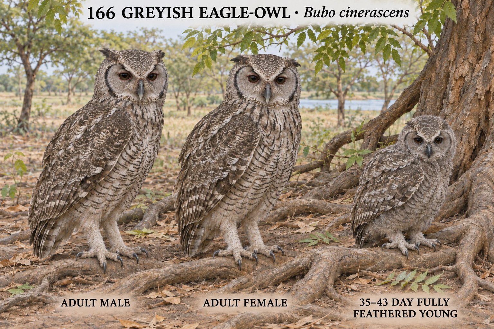
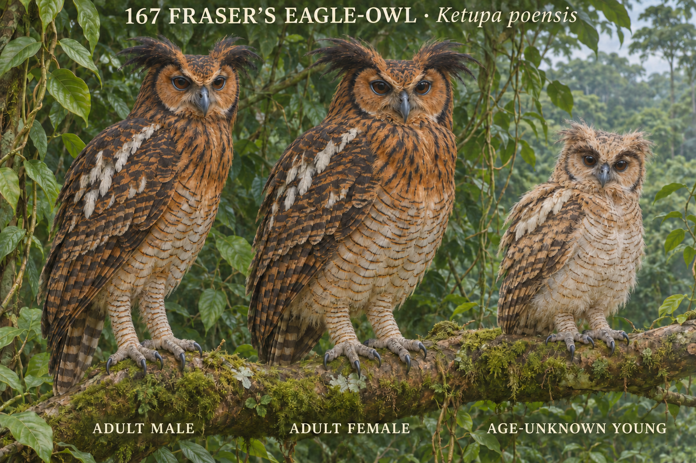
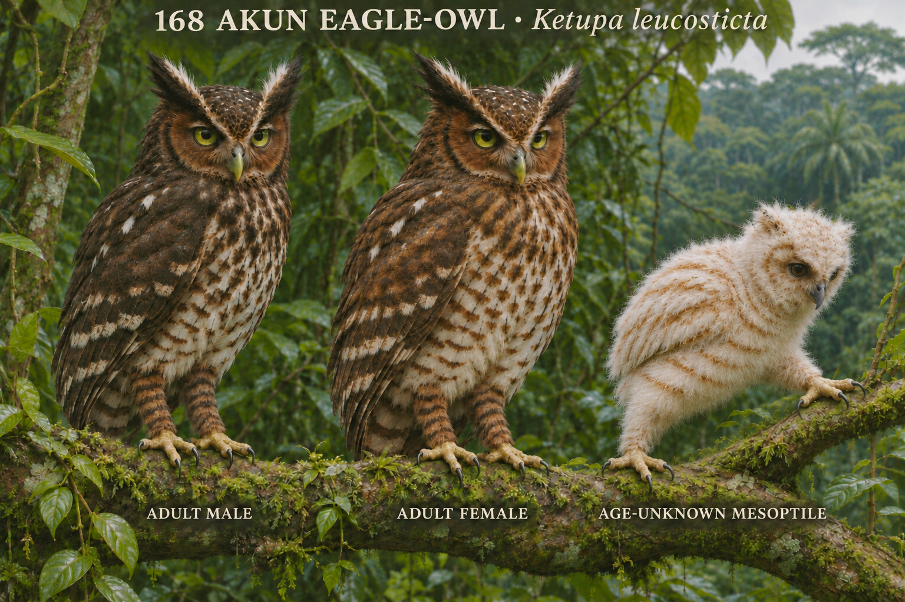
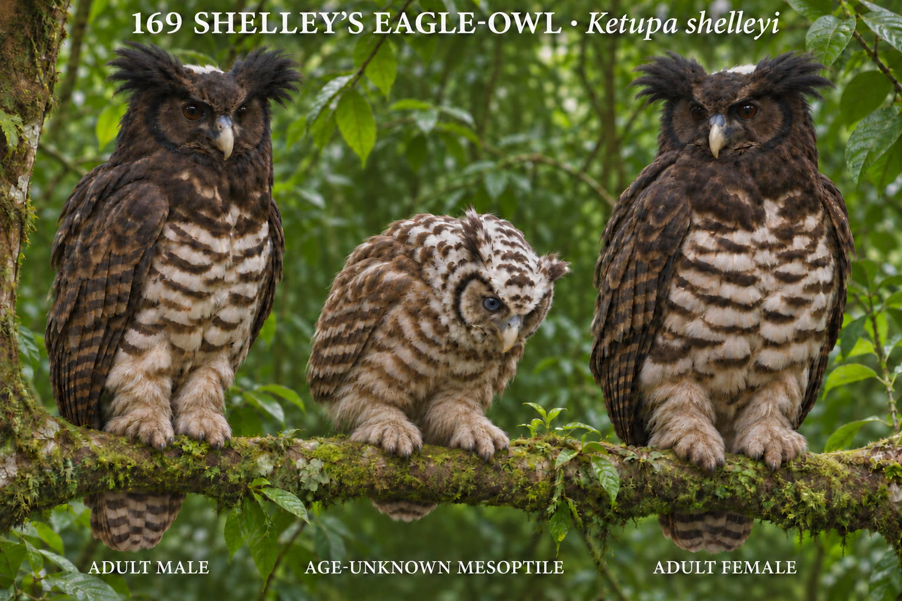

# 20261124T0936Z — completed6/6; actual originals and review
Closed2026-11-24T10:10Z (Beijing18:10; exactfinalcommit timestamp inGitHub). Main checked at 88b09bd41adf00fb5c2fde1c6beca602cf9de64b; nontruncated5876tree,998numberedconceptversions,952manifestversions,209rawtaxonstems→206speciesusingexisting3aliasmaps. Scope251contract, remaining45. No newtaxonomyreconciliation/globaltaxon-countclaim.

## Honest execution accounting
This batchsixcycles1–6 all VERIFIED, with5done before the interveningread-only request and1afterthelatestproductionresumption. It spansrequestboundaries; **not six completed by the latest resumption alone**. Thiscontinuousconversation work also recoveredprevious0831Zcycle6/#162v4: total7completedcycles, unique+0/revisions7. Old0831Zsummary preservesitspriorfiveaspriorwork; no doublecredit. Newbatchstartedonlyafterold6/6closed. Latestresumption1cycle; ledger nowCOMPLETE6/6, lease null, otherunfinished0 (supersededduplicate/completedaliasesexcluded).

## Original access / real commits
Eachfinal1536×1024 rawPNG was actuallyviewed aftergeneration/needededits, uploadedwholebase64, blobSHAchecked, thenimmutable remoteGET byte/SHA256/PILdecoded matchedlocal; eachrunhasRESEARCH_READY→IMAGE_GENERATED→REVIEWED→ARCHIVED→VERIFIED. Status **PASS_WITH_LIMITATIONS, scientifically_verified=false** forallsix. Priorversions/userconfirmationspreserved; no newuserconfirmation/sciencepass.
|cycle|number/version|immutableoriginal|verificationcommit|run|
|---|---|---|---|---|
|1|163-glaucidium-gnoma-v5|[original](https://raw.githubusercontent.com/janeytlin-eng/game-owl-ket/523a3c9e0ff12ded14cf551737cdf3f6e6a76490/owl-pet/design/concepts/163-glaucidium-gnoma-v5.png)|[79638af2](https://github.com/janeytlin-eng/game-owl-ket/commit/79638af29de9313a0fd3f9bf5f6adb9a3a4ab744)|[run](../runs/20261124T0936Z-cycle1.md)|
|2|165-ninox-punctulata-v5|[original](https://raw.githubusercontent.com/janeytlin-eng/game-owl-ket/06fb5e1db3ca596e4bce8282061f31cb14320e3a/owl-pet/design/concepts/165-ninox-punctulata-v5.png)|[46cb5046](https://github.com/janeytlin-eng/game-owl-ket/commit/46cb504686ad29a1bdf5e768fc9cca86d678b32e)|[run](../runs/20261124T0936Z-cycle2.md)|
|3|166-bubo-cinerascens-v5|[original](https://raw.githubusercontent.com/janeytlin-eng/game-owl-ket/986168aad76968bd0bb8c95a7fe4494debfc6d1e/owl-pet/design/concepts/166-bubo-cinerascens-v5.png)|[d2ccc8e7](https://github.com/janeytlin-eng/game-owl-ket/commit/d2ccc8e7a2273b2ca12a49efbb9cd882b85d7b93)|[run](../runs/20261124T0936Z-cycle3.md)|
|4|167-ketupa-poensis-v5|[original](https://raw.githubusercontent.com/janeytlin-eng/game-owl-ket/07792cd9b2cf2295584b26f6e51d7df9b3fc57bb/owl-pet/design/concepts/167-ketupa-poensis-v5.png)|[74d5b69a](https://github.com/janeytlin-eng/game-owl-ket/commit/74d5b69a5bde5dfd17b91894c12413921000ed8f)|[run](../runs/20261124T0936Z-cycle4.md)|
|5|168-ketupa-leucosticta-v5|[original](https://raw.githubusercontent.com/janeytlin-eng/game-owl-ket/8b8838d00248a55e1d4f483bde9930b2f2a696a1/owl-pet/design/concepts/168-ketupa-leucosticta-v5.png)|[aa82353d](https://github.com/janeytlin-eng/game-owl-ket/commit/aa82353d373bddf12c0b8eeacb63c25aa76f8dd8)|[run](../runs/20261124T0936Z-cycle5.md)|
|6|169-ketupa-shelleyi-v5|[original](https://raw.githubusercontent.com/janeytlin-eng/game-owl-ket/e48283c491f777470107528b00a642e59b276b8e/owl-pet/design/concepts/169-ketupa-shelleyi-v5.png)|[00c78369](https://github.com/janeytlin-eng/game-owl-ket/commit/00c783697e46023e190830b32948e7285ef9ddc0)|[run](../runs/20261124T0936Z-cycle6.md)|

Additionalcompletedthisconversation: [#162v4 original](https://raw.githubusercontent.com/janeytlin-eng/game-owl-ket/c1df6eaf10d371e09924e8d9102089988343dae4/owl-pet/design/concepts/162-glaucidium-hoskinsii-v4.png) / [verification](https://github.com/janeytlin-eng/game-owl-ket/commit/91e9a89f24ca2b60f3afff514253bc13de7ae342) / [oldbatch6/6summary](20261124T0831Z-completed-review.md). Notanewspeciestaxon.

## Research / evidence corrections
[Sourceindex](../../research/SOURCE_INDEX.md): thisbatchnew1GNOMA-ORI-MOUNTAIN; reused14source-IDreferences(duplicatepublicationreferences, NOT14newpublications), corrected10evidence/designboundaries. Including162recovery:new1/reused17references/corrected12. Mikkolauploadactuallyreadprinted375/PDF377,485/487,282/284,284/286,278/280,288/290. ExternalreadsincludeORIinstitution/AOUhistoricproposal, O’ConnellprimaryPDF291–292Fig3Aactuallyviewed, BarlowauthorfulltextTable2/captions, Sharpeoriginalpages42/37,Cornell2022taxonbody,MNHNspecimenhistory,TobiasoriginaladultPDFbody. Notallprimaryphotofiguresfreshlyviewed: exactaccesslimitsintheperspeciesrecords.
- #163v5: selectedmesoptileunspottedgreycrown/greycere; ORIgenericspottedyoungconflicthasnoage, notcombinedintofakechronology. AOUURLalreadyindexed, initialnew2discoverycountcorrectedbeforegenerationtonew1.
- #165v5: adultgreenishyellowbills, darkyoungbody; initialadult-to-younggreenbillleakcaught, edit2restoredyounggrey. PrimaryFig3Ayoungnotneonatal/age/flightproof; mesoptilewing/tailadultlikebookboundarypreventsfalseall-wingbudrule.
- #166v5: selecteddarkbrowniris/palertippedleadbill/subtlereddishadultlid; museumolive/blacklabelconflictretained.35–43dayfullyfeatheredgreyrootstagecomesfromsameprimaryrecord, flightunknown.
- #167v5: stage-specificdarkbrowzone; adultpalebluishlidrims; initialjuvenileblue-ringtransfercorrectedbyedit2tolowerneutralcontrast. Smallcoolhighlightnotclaimedlivingyoungcolour.
- #168v5: removed50day-to-whiteplumagecomposite, labelAGE-UNKNOWNMESOPTILE. Younggreenbillinheritedfromv4neutralizedasartisticnon-diagnosticgrey, notnewfact. Perséebodyfindfailed/PDFHTTP403; snippetsnotfreshprimaryread. MNHNinitialshelleyiIDactuallycorrected2020toAkun, excludedfrom#169.
- #169v5: selectedguide-mesoptiledarkblueiris. First2attemptsleftbrownouterringseenin6×crops; edit3withsupportingzoom changedwholeannulus, finalcropactuallyviewed. Secondaryguideonly; noindependentagedyoungphoto oririsontogenyresolved. Figure10inTobiasisjuvenileVerreauxandexcluded.

## Self-iteration / regression review
Stage/source/taxonlimitsmustprecedecolour/ageedits. Adultsoftpartsleakedtoyoungdespitepromptin165/167; sameprotectiondidnotfixinherited168greenbill. Thisisobservedpromptfailure, notclaimedprevention. Manualview+singlefeaturecorrectionworksforlocalcasesonly. #169fullplateviewinsufficientforirisannulus; cropsrevealedfailedattemptsandavoidedfalsecredit. Crosschecksretained #162finecrownstreaks vs163unspottedmesoptile,166same-individualageinterval vs168compositeage, anddifferenttaxons'iriscolourswithoutcopyingblueacrossall. No historicalimageautomaticallyscientificallypassed.

## Timing / bottlenecks / errors
[Phaseevidence](20261124T0936Z-phase-evidence.json) recordsactualstart/research-ready/commitdates/toolwaits, notestimatedfixedruntime. Sixcycleimage-toolwaits total381.7seconds across11calls; eachfirstcallisarevisionoftheexistingplate, extra5callsarecorrectiveiterations. Archive-to-VERIFIED elapsed includesremoteGET/hash/decode andtextcommit, notpureupload. Somecorrectivecallswerepreservedasartifacts beforefinal. Researchelapsedincludestextread/commits/temporaryread-onlyinterruption, notpureactivework. Knownerrors: largecombinedtooloutputtruncated→boundedreread; BBOCweb40036MB→localoriginaldownloadsuccess; PerséeHTTP403notresolved; imagefeatureeditfailuresrecordedbeforecredit. No platformfixedtimeouttelemetry obtained.

## Remaining / next
45contractspeciesstillwithoutuniqueconceptandall206needscientificcalibration. Exactjuvenileage/softpartchronology/flight/sexlinearratiosoftenunknown. Full251authoritativechecklistcrosswalkandwholelistcentralreviewremainunfinished; existingnumberedfilesarenotproof251currenttaxafullyreconciled. Nextnewbatch1/6mustfreshmain/leasecheckandpreferexplicitmissing-speciesorunresolved-evidencequeuewithoutduplicatingjustverifiedversions. Nootherunfinishedbatch, no activelease, no otherautomation/taskchanged; tasknotdeclaredfinished.

## Full original gallery

### 163-glaucidium-gnoma-v5
[Research](../../research/species/163-glaucidium-gnoma-v5.md) · [actualreview](../../research/reviews/163-glaucidium-gnoma-v5-review.md) · [completeprompt](../../research/prompts/163-glaucidium-gnoma-v5.txt)

### 165-ninox-punctulata-v5
[Research](../../research/species/165-ninox-punctulata-v5.md) · [actualreview](../../research/reviews/165-ninox-punctulata-v5-review.md) · [completeprompt](../../research/prompts/165-ninox-punctulata-v5.txt)

### 166-bubo-cinerascens-v5
[Research](../../research/species/166-bubo-cinerascens-v5.md) · [actualreview](../../research/reviews/166-bubo-cinerascens-v5-review.md) · [completeprompt](../../research/prompts/166-bubo-cinerascens-v5.txt)

### 167-ketupa-poensis-v5
[Research](../../research/species/167-ketupa-poensis-v5.md) · [actualreview](../../research/reviews/167-ketupa-poensis-v5-review.md) · [completeprompt](../../research/prompts/167-ketupa-poensis-v5.txt)

### 168-ketupa-leucosticta-v5
[Research](../../research/species/168-ketupa-leucosticta-v5.md) · [actualreview](../../research/reviews/168-ketupa-leucosticta-v5-review.md) · [completeprompt](../../research/prompts/168-ketupa-leucosticta-v5.txt)

### 169-ketupa-shelleyi-v5
[Research](../../research/species/169-ketupa-shelleyi-v5.md) · [actualreview](../../research/reviews/169-ketupa-shelleyi-v5-review.md) · [completeprompt](../../research/prompts/169-ketupa-shelleyi-v5.txt)

