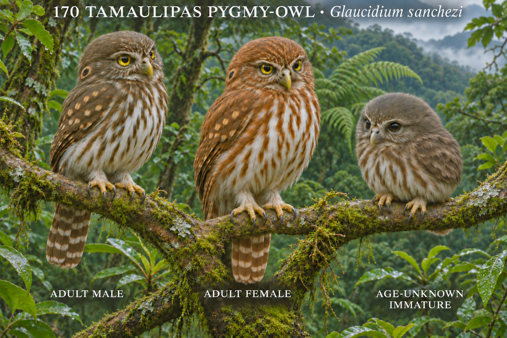
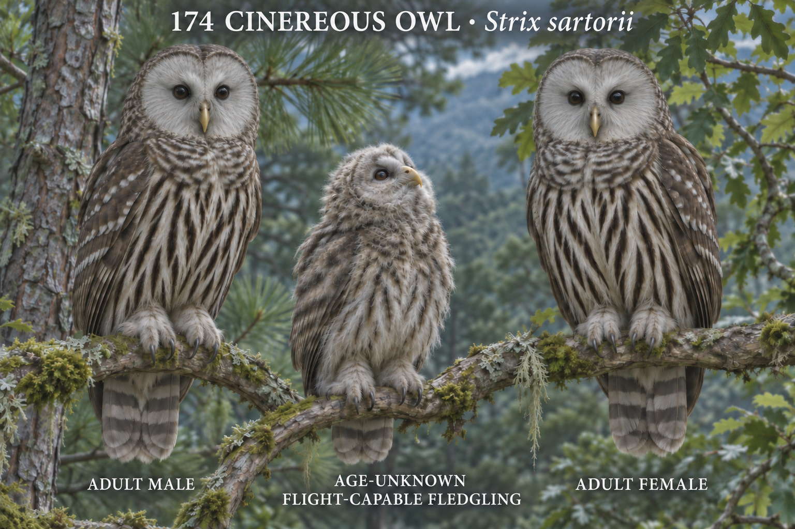
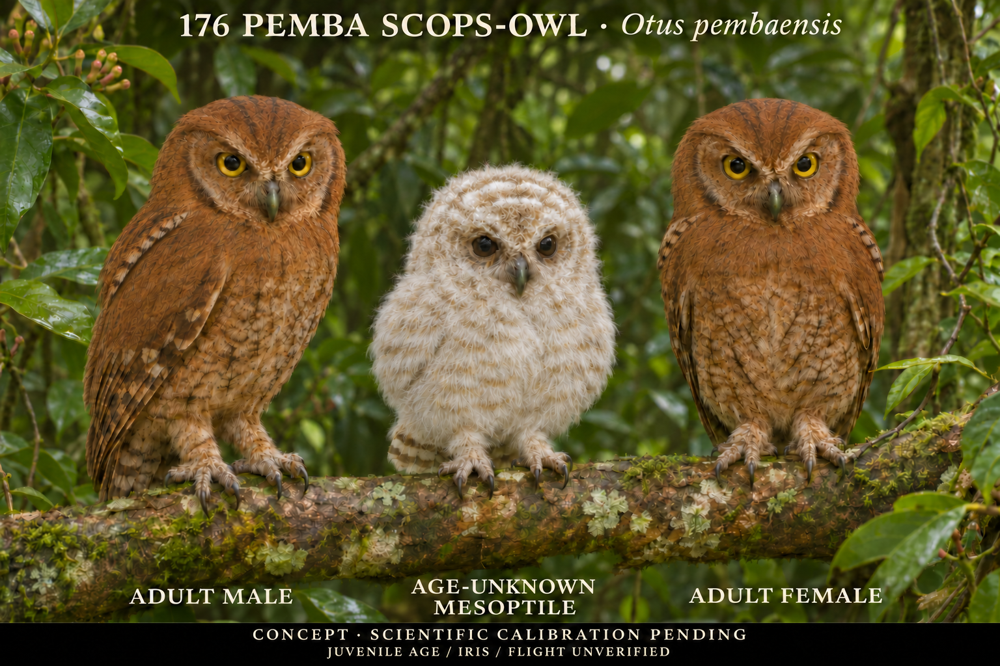
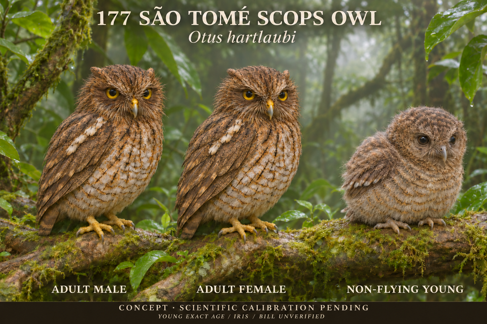
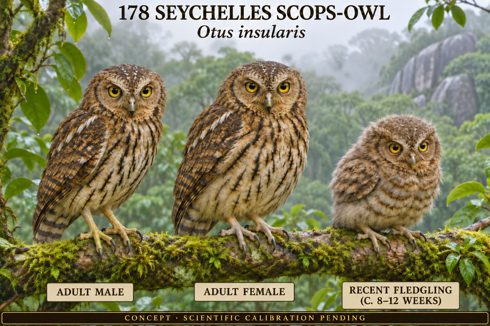
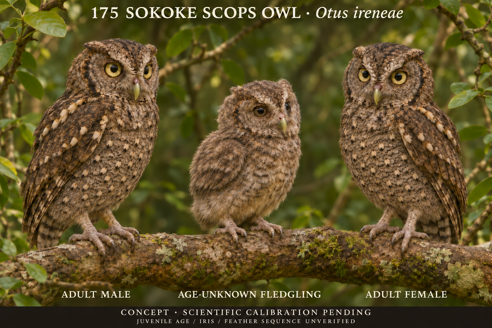

# 20261124T1031Z — 6/6 completed
Start2026-11-24T10:31Z; closed2026-11-24T10:51:39.393Z. **This invocation actually completed6 serial productioncycles**, not6stages orplans. Newtaxa0/revised6; scope206/251unchanged, remaining45. Numberedconceptversions998→1004; designmanifest952→958. Existingaliasmapsused, nofullyreconciled2026globaltaxonomyclaim. Previousbatchescompletebeforestart; ledgerreadbackCOMPLETE6/6/lease=null/otherunfinished0.

## Original gallery and actual commits
Eachfinalfull1536×1024PNGactuallyviewed, archivedwholebase64/blobSHAchecked, immutableGETbytecount/SHA256/PILdecodedmatchedlocal. Research/prompt/index/review/lesson/runfilesreadback; fivepersistedstages each. All **PASS_WITH_LIMITATIONS/scientifically_verified=false**, no newuserconfirmation/scientificpass. Originalversionskept.

|cycle|version|original|verification|run|
|---|---|---|---|---|
|1|170-glaucidium-sanchezi-v5|[PNG](https://raw.githubusercontent.com/janeytlin-eng/game-owl-ket/5425ef0f6b2a5811811ac8959a1d61f77585bbb5/owl-pet/design/concepts/170-glaucidium-sanchezi-v5.png)|[8e9aaead](https://github.com/janeytlin-eng/game-owl-ket/commit/8e9aaeadddad17219a44e2917cdefddd1dac518e)|[run](../runs/20261124T1031Z-cycle1.md)|
|2|174-strix-sartorii-v5|[PNG](https://raw.githubusercontent.com/janeytlin-eng/game-owl-ket/11866492dd83fe3c37bc76c613ac4abd96829664/owl-pet/design/concepts/174-strix-sartorii-v5.png)|[eb95f1f5](https://github.com/janeytlin-eng/game-owl-ket/commit/eb95f1f51787fb0f37545cd50bbfd9112e68e035)|[run](../runs/20261124T1031Z-cycle2.md)|
|3|176-otus-pembaensis-v6|[PNG](https://raw.githubusercontent.com/janeytlin-eng/game-owl-ket/3307b3bdc6267962e9dfb11a0f8358e76fae69c6/owl-pet/design/concepts/176-otus-pembaensis-v6.png)|[a7ad8162](https://github.com/janeytlin-eng/game-owl-ket/commit/a7ad8162efcb6dab06f274d26a0403ba1f9c1e4a)|[run](../runs/20261124T1031Z-cycle3.md)|
|4|177-otus-hartlaubi-v6|[PNG](https://raw.githubusercontent.com/janeytlin-eng/game-owl-ket/2a75c8ff32c280feecb8e2c40e4dd58956e20bc4/owl-pet/design/concepts/177-otus-hartlaubi-v6.png)|[dbfe38b3](https://github.com/janeytlin-eng/game-owl-ket/commit/dbfe38b328e7be15c9dd13527d502cb772dad27c)|[run](../runs/20261124T1031Z-cycle4.md)|
|5|178-otus-insularis-v6|[PNG](https://raw.githubusercontent.com/janeytlin-eng/game-owl-ket/d804462fb5779a2b447171b3abd5df937da57468/owl-pet/design/concepts/178-otus-insularis-v6.png)|[15e1ff2b](https://github.com/janeytlin-eng/game-owl-ket/commit/15e1ff2b9b994184615b1c4706b4c75902defac8)|[run](../runs/20261124T1031Z-cycle5.md)|
|6|175-otus-ireneae-v6|[PNG](https://raw.githubusercontent.com/janeytlin-eng/game-owl-ket/6e913fd157431c8edd9baf54f5afe5cd0fcb0dec/owl-pet/design/concepts/175-otus-ireneae-v6.png)|[0145a3fa](https://github.com/janeytlin-eng/game-owl-ket/commit/0145a3fad88c374dab6277b745451ef8ef7ea870)|[run](../runs/20261124T1031Z-cycle6.md)|

## Actual research / iteration
Sourceindex [SOURCE_INDEX.md](../../research/SOURCE_INDEX.md): new0/reused11source-IDreferences/corrected6designboundaries. Reuse countincludesrepeatedsamebookreferences, not11publications. UseruploadedMikkolaactuallyreadprinted384/PDF386,135/137,136/138,138/140,134/136. #174usescurrentMexicanspeciesprimaryfieldaccount; broadoldvariaguideisnotyoungproof. Externalprimary/ institutionalbodyreads: Puente-Zozayaetal2024pp63–65, Pieplow&Spencer2015Thefind/Visuals, PeregrineFundPembabody, deNaurois1975pp325–328originalexistingPDF, Currieetal2004pp124/127–128, Virani2008pp6–8. No newthirdpartyphotoimagescopied, no freshlyviewedsourcephotopixelclaimwhereonlybody/captionread.
- #170v5: youngsaturatedyellow-greencere→greycere/hornbase, adultyellowsoftpartsandsexpalettepreserved. Stage-specificbookp384, noexactyoungage/flight/irisproof.
- #174v5: adultlowerstreaksmediumbrown→coldnearblacksepia, primaryfielddescription. Youngformedflightfeathersretainedbecausedirectflightobserved; noforcedneonatalwingbuds.
- #176v6: mesoptilebodygroundstrongrufous→dirtywhitishwithvagueyellowbrownbars, preservewhitebarredcrown/nonnatalstage/adultpreviousfixes. Youngage/iris/flightunknown.
- #177v6: overlycleanroundadultfacialborder→hirsuteirregularfeathers, primaryp326'no true disc'. Bookdescriptivefacialdiscwordconflictretained. Finalbristleprojectionstrongerthanprior andunmeasured, remainsconceptcalibrationlimit. Youngfinenarrowbars/whiteinnertertialedges retained.
- #178v6: adultpaleendbill→darkhorntip/grey-yellowbase. Youngbilluntouched, c8–12weekfieldcategorynotexactagephotoreconstruction; noflightthresholdclaim.
- #175v6: adultbaretoessaturatedgold→pal egrey-brown. Exposedanklecolouralsodesaturated, notliteralpixel-preservation; precisetarsalfeatherboundarypending. Centreyoungsoftpartsunverifiedretained.

## Evidence-backed self-iteration
Differenttracts/stagescheckedindependently: cere vsbilltip, ventralshaftstreaks vscrossbars, youngground vscrown, discboundary vsbristlelength, footankle/toes/claws. Localeditsvisuallyeffectivefortargetsbutnotproofwhole-imagebiologicalaccuracy. Regressionchecks preservedprior176adultcrown/scapularfixand177adultwing/tailfix, preventedapplying178blackbilltipto175/177, retained174youngformedwingsanddidn'ttransferadulttoecolourtoyoung. Noallowlfemale-larger/bodyheightformula. Bodyheight/feathergeometry/colourstillnotquantitativelycalibrated. Proposednextchecks:177bristleprojection/175tarsalfeatherboundary againstreliablelivingphotos, notassumedvalidated.

## Timing / actual errors
[Phase evidence](20261124T1031Z-phase-evidence.json) recordsstart/researchReady/imageGenerated/reviewed/verifiedtimestamps/bytes/hashes/commits. Builtinimagegentoolwaits32.2/38.4/38.6/42.2/36.5/37.7seconds,total225.6s. Siximagecallswereeachactualedits ofexistingversions, noextraunreviewedgenerationcounted. Research/archivingwallclock includesreads/commits, notpureactivework; uploadtimeisnotindependentlyinstrumented. Errors:wrongcandidate176-thilohoffmannipath404correctedfromactualtree; notconnectorfailure. SORAHowellRobbinsPDFredirectedUSFmigrationhomepage/notread; CatryPDFwebinaccessible/notfreshread; deNauroisweb403recoveredexistingoriginalfullPDFactualread. Noerrorsforcedearlyexit,no fixedplatformtimeouttelemetry.

## Remaining / handoff
Currentbatch6/6closed, nextnewbatch1/6afterfreshmainleasecheck; otherunfinished0. Still45contractspeciesunarchived andall206uniqueconceptsneedscientificcalibration; no full251centralreviewcompleted. #227Otuscapnodesexistingdeferredrecordreread: primaryadult/habitatavailablebutyoungstillunverified; nofakechick/newtaxoncredit. #231Ninoxforbesiremainsdeferredpendingyoungstageevidence. Newmissing-species/rosterreconciliation shouldbe prioritizedonceprimaryyoungsupportavailable. Nootherproject/task/automationchanged, noall-speciescompletionclaim.

## Full-resolution originals

### 170-glaucidium-sanchezi-v5
[Research](../../research/species/170-glaucidium-sanchezi-v5.md) · [actualreview](../../research/reviews/170-glaucidium-sanchezi-v5-review.md) · [fullprompt](../../research/prompts/170-glaucidium-sanchezi-v5.txt)

### 174-strix-sartorii-v5
[Research](../../research/species/174-strix-sartorii-v5.md) · [actualreview](../../research/reviews/174-strix-sartorii-v5-review.md) · [fullprompt](../../research/prompts/174-strix-sartorii-v5.txt)

### 176-otus-pembaensis-v6
[Research](../../research/species/176-otus-pembaensis-v6.md) · [actualreview](../../research/reviews/176-otus-pembaensis-v6-review.md) · [fullprompt](../../research/prompts/176-otus-pembaensis-v6.txt)

### 177-otus-hartlaubi-v6
[Research](../../research/species/177-otus-hartlaubi-v6.md) · [actualreview](../../research/reviews/177-otus-hartlaubi-v6-review.md) · [fullprompt](../../research/prompts/177-otus-hartlaubi-v6.txt)

### 178-otus-insularis-v6
[Research](../../research/species/178-otus-insularis-v6.md) · [actualreview](../../research/reviews/178-otus-insularis-v6-review.md) · [fullprompt](../../research/prompts/178-otus-insularis-v6.txt)

### 175-otus-ireneae-v6
[Research](../../research/species/175-otus-ireneae-v6.md) · [actualreview](../../research/reviews/175-otus-ireneae-v6-review.md) · [fullprompt](../../research/prompts/175-otus-ireneae-v6.txt)

