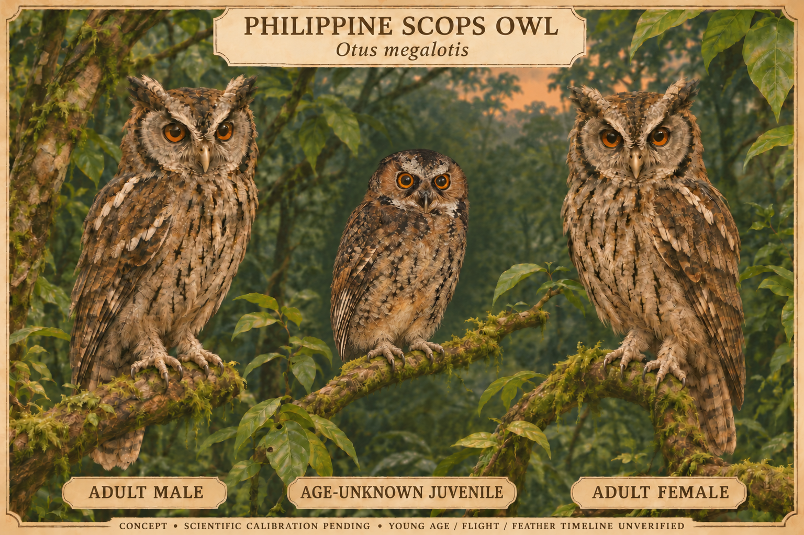
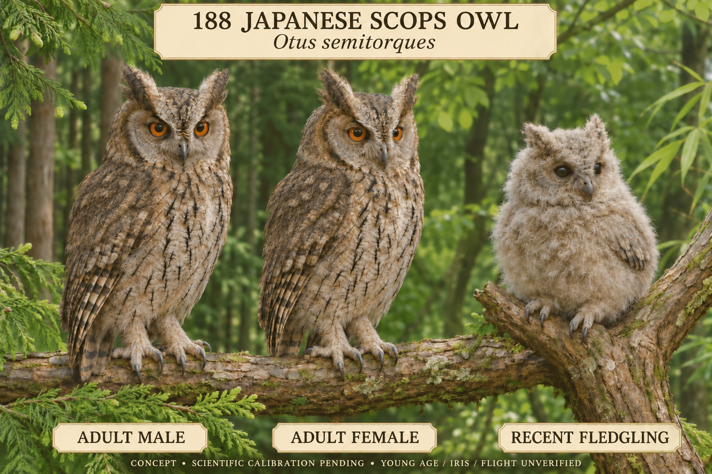
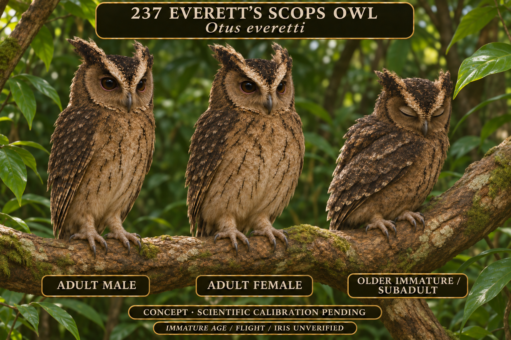
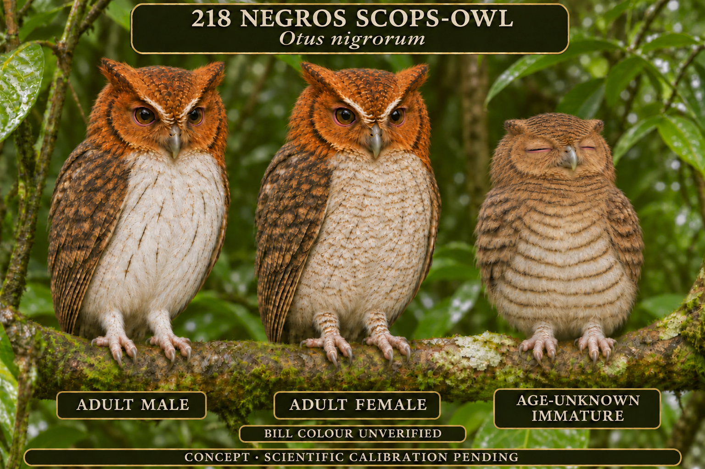
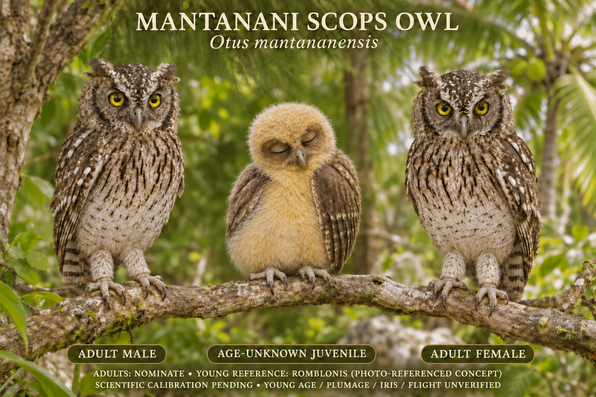
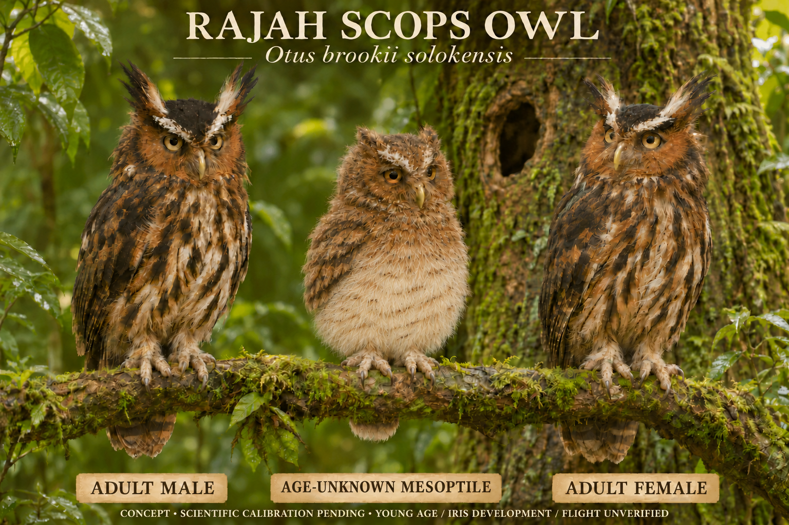

# 20261124T1204Z — 本次串行完成6/6

实际执行2026-11-24T12:04:06.767Z–2026-11-24T12:33:11.008Z（北京时间20:04–20:33）。本次6轮全部独立研究、实际imagegen编辑/查看、必要纠正/复查、来源索引与经验记录提交、完整PNG远端归档和回读后记账。7次实际imagegen编辑产生6张最终组图＋#195首稿；首稿不计物种或另一修订。前1137Z批次入口补齐不重计本次六轮。

新增物种0，修订6物种／6版本；去重206/251不变，尚45。main完整非截断树重新统计编号图版本1010→1016，design/manifest条目964→970，原始学名文件词干209，沿用已有3别名归并得206，不把修订／同物种不同编号重复计数。约定251未变，本次未完成全球分类名录对齐，不能声称251为已核实最新分类总数。所有六图scientifically_verified=false；新增科学通过0、用户确认0；旧图版本和历史确认不变。

## 六张原图与证据

|轮次|编号／版本与修订|完整PNG原图|依据／实际复查|VERIFIED提交|记账提交|
|---|---|---|---|---|---|
|1/6|197-otus-megalotis-v6：幼鸟翼端收回至脚／枝条附近，保留已成形飞羽|[原图](https://raw.githubusercontent.com/janeytlin-eng/game-owl-ket/c07009f20f62d4cf86325d65dc53fab89a0794d9/owl-pet/design/concepts/197-otus-megalotis-v6.png)|[研究与完整提示](../../research/species/197-otus-megalotis-v6.md) · [复查](../../research/reviews/197-otus-megalotis-v6-review.md) · [运行](../runs/20261124T1204Z-cycle1.md)|[db5269f4](https://github.com/janeytlin-eng/game-owl-ket/commit/db5269f41d14a819651ceda99ba0a4d546d8a472)|[dc4b7f8c](https://github.com/janeytlin-eng/game-owl-ket/commit/dc4b7f8c43033bac9dab38340bf019d1377864f6)|
|2/6|188-otus-semitorques-v5：成年过强白肩纹收弱，保留下部飞羽横斑|[原图](https://raw.githubusercontent.com/janeytlin-eng/game-owl-ket/43b059c131182dcee7ad7454cc9b20d7ff846158/owl-pet/design/concepts/188-otus-semitorques-v5.png)|[研究与完整提示](../../research/species/188-otus-semitorques-v5.md) · [复查](../../research/reviews/188-otus-semitorques-v5-review.md) · [运行](../runs/20261124T1204Z-cycle2.md)|[6ce695bd](https://github.com/janeytlin-eng/game-owl-ket/commit/6ce695bdc90f83d316bbff13e7764d3e494a91b4)|[287a522e](https://github.com/janeytlin-eng/game-owl-ket/commit/287a522e8827a2c53d606ba4c17fca2b39323f79)|
|3/6|237-otus-everetti-v2：成年误套的白肩长楔收弱，不改未成熟鸟|[原图](https://raw.githubusercontent.com/janeytlin-eng/game-owl-ket/fada41a9a5f2da7cf2300713cd3b3b0d0a5153cd/owl-pet/design/concepts/237-otus-everetti-v2.png)|[研究与完整提示](../../research/species/237-otus-everetti-v2.md) · [复查](../../research/reviews/237-otus-everetti-v2-review.md) · [运行](../runs/20261124T1204Z-cycle3.md)|[d64b0b66](https://github.com/janeytlin-eng/game-owl-ket/commit/d64b0b66db037baf9469c65c67aa9e397758cee9)|[9c402159](https://github.com/janeytlin-eng/game-owl-ket/commit/9c4021599f363e5749f17f313d054586fb50eb52)|
|4/6|218-otus-nigrorum-v3：未成熟鸟头颈改为细暗横斑，不改成年肩纹|[原图](https://raw.githubusercontent.com/janeytlin-eng/game-owl-ket/d48a31b75fe92986122c11ca371f7482f248d533/owl-pet/design/concepts/218-otus-nigrorum-v3.png)|[研究与完整提示](../../research/species/218-otus-nigrorum-v3.md) · [复查](../../research/reviews/218-otus-nigrorum-v3-review.md) · [运行](../runs/20261124T1204Z-cycle4.md)|[f28a0ed5](https://github.com/janeytlin-eng/game-owl-ket/commit/f28a0ed5f6e7790c39225ff8ca5523f5a7eaced5)|[7b73cdaa](https://github.com/janeytlin-eng/game-owl-ket/commit/7b73cdaa08c6adc0d0027a2831c9a4bc2da89865)|
|5/6|201-otus-mantananensis-v6：指名亚种成年上胸较重、下腹较浅，保留白肩纹|[原图](https://raw.githubusercontent.com/janeytlin-eng/game-owl-ket/591d1bd905c382ddabefd8faf5e046ce3b50550a/owl-pet/design/concepts/201-otus-mantananensis-v6.png)|[研究与完整提示](../../research/species/201-otus-mantananensis-v6.md) · [复查](../../research/reviews/201-otus-mantananensis-v6-review.md) · [运行](../runs/20261124T1204Z-cycle5.md)|[404ec7ea](https://github.com/janeytlin-eng/game-owl-ket/commit/404ec7ea8be9a25a8931f1650679de716f6be567)|[82bd1226](https://github.com/janeytlin-eng/game-owl-ket/commit/82bd12268fa3d8887e1c1185a8786dd430f4482d)|
|6/6|195-otus-brookii-v5：幼鸟下腹改浅并保留细暗斑，首稿不足后再次编辑|[原图](https://raw.githubusercontent.com/janeytlin-eng/game-owl-ket/c2f57b205b565d9bb19e2c0229b040e039f9493d/owl-pet/design/concepts/195-otus-brookii-v5.png)|[研究与完整提示](../../research/species/195-otus-brookii-v5.md) · [复查](../../research/reviews/195-otus-brookii-v5-review.md) · [运行](../runs/20261124T1204Z-cycle6.md)|[3be31a5a](https://github.com/janeytlin-eng/game-owl-ket/commit/3be31a5ad7a7fb02f3718643b741535c29406452)|[4b34e438](https://github.com/janeytlin-eng/game-owl-ket/commit/4b34e43844821b40b7f19dfc50019e866c16647a)|

六张最终PNG均1536×1024，每张实际远端完整GET、字节数、SHA256、PIL解码、对应树／提交回读通过。[阶段/计时/校验元数据](./20261124T1204Z-evidence.json)。#195首稿[原始PNG](https://raw.githubusercontent.com/janeytlin-eng/game-owl-ket/b2eb83b1ae1dd6ac3a936e2b9563c7cbadd4304e/owl-pet/production/generated/195-otus-brookii-v5-initial.png)亦完整GET/PIL解码，2652017bytes SHA2560ee1f33de487c10369a10b1aaaac75eef2950cf30d2d19c7a62a949d93e2304e与本地一致。

## 研究、迭代与界限

[来源索引](../../research/SOURCE_INDEX.md)新增1条 **MANT-ZAINI-2023-MANTANANI-FIELD**，复用14次既有源ID引用（按各子轮计，非14篇新文献；同本图鉴和同篇Miranda论文去重），6项设计修订。新来源2023野外观察/照片的作者、日期、URL、实际图片与可见/遮挡/照明限制见#201研究。各轮均主动外部检索或重读原始外部正文／实物影像并读可访问上传图鉴页，非仅搜索摘要。

实际经验：白肩纹须逐种检查，188/237收弱而197/201保留；218回查成年无同类错误，未重复修改。幼鸟已成形翅羽按具体阶段保留，不因绒羽外观统一擦成翼芽。195首稿实际目标不足，已保存首稿后第二次编辑，复查浅腹底达成；不把初稿直接称通过。详见每轮[经验目录](../../research/iterations/)。幼鸟确切年龄、虹膜时序、首飞阈值、量化雌雄差及部分颜色／羽被区域冲突仍待校准；概念完成不等于科学验收。

## 实际错误与恢复

- Library读页曾用错误pages参数，随后用正确页窗读取成功；生成未失败。
- 本地助手试图序列化函数失败、旧manifest缺id字段的筛选错误，均在相应Git写入前修正；运行记录保留。
- 一次三图合并查看输出达到实际响应上限，第三张237丢弃；没有当作已看，后续单独查看237成功。
- #237的2022Zenodo论文新开页面InternalError；此次成年校对用实际读到的2011原始比较／成年实照，未伪称重读未成熟图。
- 上传图鉴渲染图片不可用时，仅称实际读文本/图注，另读外部实物照片，不伪称看见书页照片。
- cycle6开始提交首次即时head回读旧值；重新检查main确认自己的4512b232提交/父提交/lease后恢复同一轮，无重复图或计数。
- 无审批拒绝、无GitHub实际上传失败、无平台固定超时遥测；不推断固定执行时长限制。

## 接续状态

当前批次6/6 COMPLETE，lease已释放。其他有效未完批次0；旧SUPERSEDED_DUPLICATE不是运行中，COMPLETED且6/6也不重开。下一子轮为下一新批次1/6，需先读最新main/lease及待修/缺图资料再选项目。本次不启动下一批、不更改自动化或其他项目；全任务未完成，不暂停生产任务。45种缺图仍需逐种查证和全名录对齐，不能把某个候选缺幼羽推广为45种全部资料不足。

## 全部最终组图

### 197-otus-megalotis-v6

幼鸟翼端收回至脚／枝条附近，保留已成形飞羽。概念图，待科学校准。

### 188-otus-semitorques-v5

成年过强白肩纹收弱，保留下部飞羽横斑。概念图，待科学校准。

### 237-otus-everetti-v2

成年误套的白肩长楔收弱，不改未成熟鸟。概念图，待科学校准。

### 218-otus-nigrorum-v3

未成熟鸟头颈改为细暗横斑，不改成年肩纹。概念图，待科学校准。

### 201-otus-mantananensis-v6

指名亚种成年上胸较重、下腹较浅，保留白肩纹。概念图，待科学校准。

### 195-otus-brookii-v5

幼鸟下腹改浅并保留细暗斑，首稿不足后再次编辑。概念图，待科学校准。

