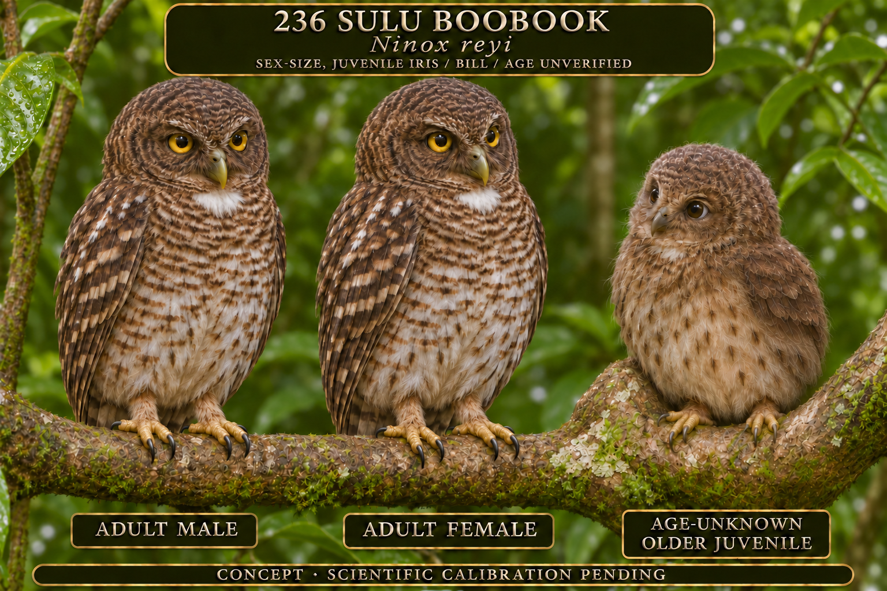
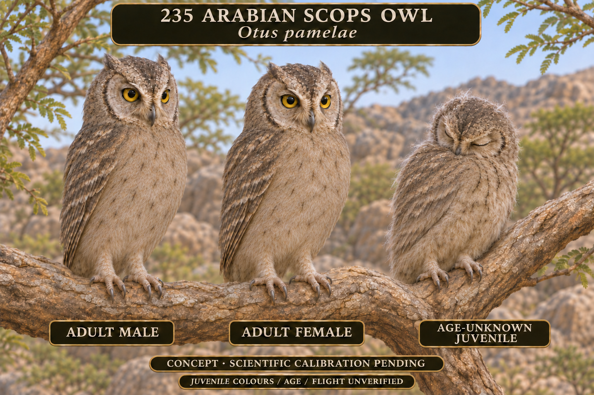
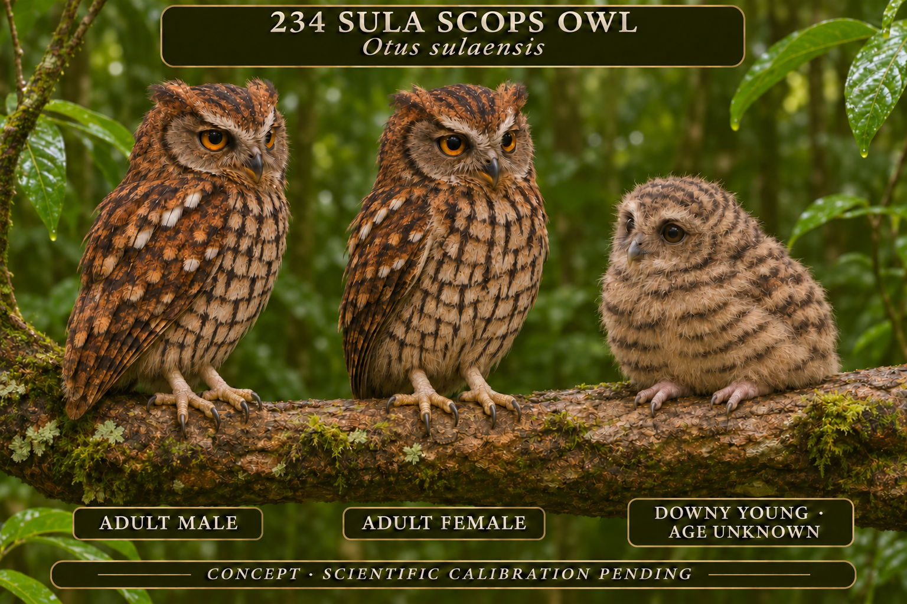
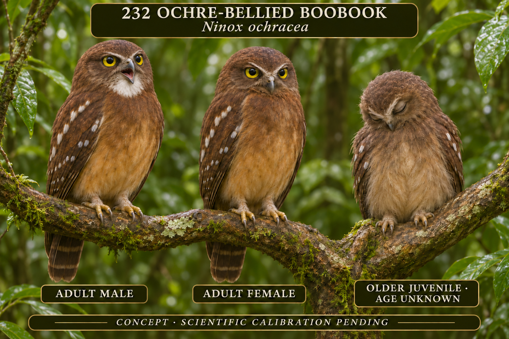
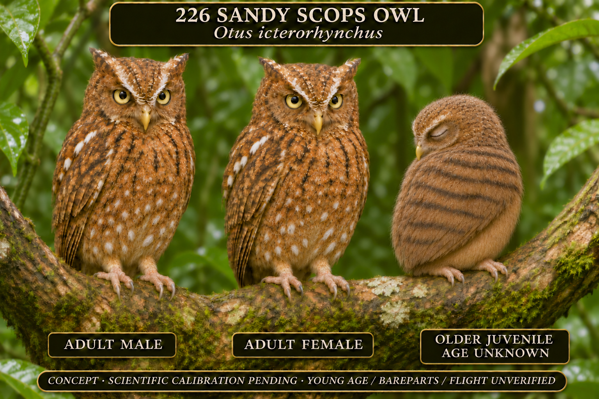
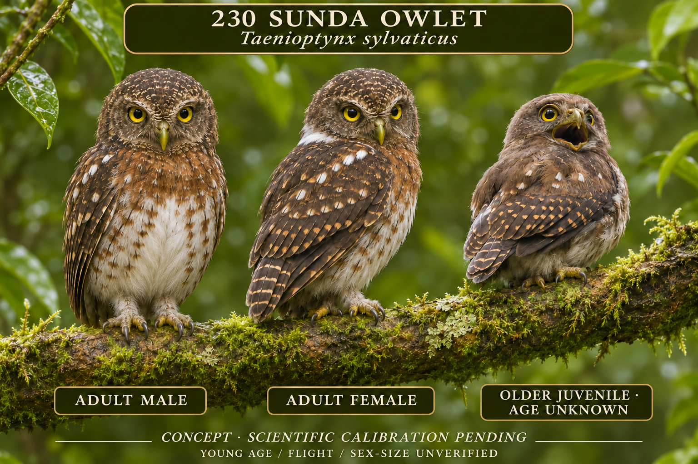

# 20261124T1332Z — 本次串行完成6/6

截至2026-11-24 13:56:03 UTC（北京时间+8小时）。本批实际从2026-11-24T13:31:38.778Z至2026-11-24T13:54:18.448Z完成6个独立子轮，6次内置imagegen编辑，六张最终PNG全部实际查看、研究/索引/提示/经验/阶段提交、远端完整GET/字节/SHA256/PIL解码和提交回读后记账。不是6个计划或6次检索。新增0物种，修订6组，其中5项形态修订、1项明确标注ANNOTATION_ONLY；所有sciencefalse，新用户确认0。前1204Z批次成果不重计。

完整非截断main树重新计数：去重206/251，尚45；编号图片版本1016→1022；design/manifest条目970→976。209原始学名词干沿用3既有别名归并为206；同物种不同编号/版本不重复。固定251仍需完整权威分类名录对齐，本次无已核实总数变更。旧编号、所有原图版本及用户确认记录保留。

## 六张原图与逐轮证据

|轮|编号／修订|完整原图|研究／实际复查／运行|VERIFIED提交|记账提交|
|---|---|---|---|---|---|
|1/6|236-ninox-reyi-v2：成年爪改黑色、保留浅基部，未改幼鸟爪|[PNG](https://raw.githubusercontent.com/janeytlin-eng/game-owl-ket/e45637d4783b4207665c9c0dbac401a45988bb43/owl-pet/design/concepts/236-ninox-reyi-v2.png)|[研究与完整提示](../../research/species/236-ninox-reyi-v2.md) · [复查](../../research/reviews/236-ninox-reyi-v2-review.md) · [运行](../runs/20261124T1332Z-cycle1.md)|[62477f8a](https://github.com/janeytlin-eng/game-owl-ket/commit/62477f8a3f5dcc5214f1b1e3107481bec6df8dc4)|[02d49ced](https://github.com/janeytlin-eng/game-owl-ket/commit/02d49ced20f5cd66b044b96e1d0fb98818de8af7)|
|2/6|235-otus-pamelae-v2：成年胸腹长黑纹收弱为少量断续细纹|[PNG](https://raw.githubusercontent.com/janeytlin-eng/game-owl-ket/f8732385e1d018355a98c5e71fe1d215b0272a35/owl-pet/design/concepts/235-otus-pamelae-v2.png)|[研究与完整提示](../../research/species/235-otus-pamelae-v2.md) · [复查](../../research/reviews/235-otus-pamelae-v2-review.md) · [运行](../runs/20261124T1332Z-cycle2.md)|[5e252192](https://github.com/janeytlin-eng/game-owl-ket/commit/5e252192604b0854e45e78341c24d21c7875e8ac)|[2bbc823e](https://github.com/janeytlin-eng/game-owl-ket/commit/2bbc823efed900abe9eb6643a7ef3946a6cb29ab)|
|3/6|234-otus-sulaensis-v3：成年腹纹补回羽轴纵纹，保留横斑|[PNG](https://raw.githubusercontent.com/janeytlin-eng/game-owl-ket/b4017f2a697f542837272a155b82158dfdca5ef7/owl-pet/design/concepts/234-otus-sulaensis-v3.png)|[研究与完整提示](../../research/species/234-otus-sulaensis-v3.md) · [复查](../../research/reviews/234-otus-sulaensis-v3-review.md) · [运行](../runs/20261124T1332Z-cycle3.md)|[5e6eb8ec](https://github.com/janeytlin-eng/game-owl-ket/commit/5e6eb8eca9a858c53ede6d17e225adead810b49b)|[52bc0525](https://github.com/janeytlin-eng/game-owl-ket/commit/52bc05250e2f19f8f50c14267b7e7605e77e8156)|
|4/6|232-ninox-ochracea-v3：成年白眉收窄为细窄X形面纹，保留鸣叫白喉|[PNG](https://raw.githubusercontent.com/janeytlin-eng/game-owl-ket/40d6d87296068faa52ef0156ebd0c264f2b6fc57/owl-pet/design/concepts/232-ninox-ochracea-v3.png)|[研究与完整提示](../../research/species/232-ninox-ochracea-v3.md) · [复查](../../research/reviews/232-ninox-ochracea-v3-review.md) · [运行](../runs/20261124T1332Z-cycle4.md)|[dfa48738](https://github.com/janeytlin-eng/game-owl-ket/commit/dfa48738b0880cba8d4e329a2b3cedb72dcacce9)|[5f802b76](https://github.com/janeytlin-eng/game-owl-ket/commit/5f802b76cf530ba52c7acbebeeab3267e088f3ea)|
|5/6|226-otus-icterorhynchus-v3：成年下腹白长块分解为白斑，保留上胸细白纹|[PNG](https://raw.githubusercontent.com/janeytlin-eng/game-owl-ket/fe126c5f79d31601bc336deeee1d12fdc15cfad5/owl-pet/design/concepts/226-otus-icterorhynchus-v3.png)|[研究与完整提示](../../research/species/226-otus-icterorhynchus-v3.md) · [复查](../../research/reviews/226-otus-icterorhynchus-v3-review.md) · [运行](../runs/20261124T1332Z-cycle5.md)|[6b3361f0](https://github.com/janeytlin-eng/game-owl-ket/commit/6b3361f096260ae4d3e856c82a938130c80dd6eb)|[f46b08b6](https://github.com/janeytlin-eng/game-owl-ket/commit/f46b08b61c9256bb2f07ea3109fcca32974e38b0)|
|6/6|230-taenioptynx-sylvaticus-v2：仅补充年龄／飞行／雌雄尺度未知标识，未改形态|[PNG](https://raw.githubusercontent.com/janeytlin-eng/game-owl-ket/ee2634b919c728e47d897560523f9477eacaa78b/owl-pet/design/concepts/230-taenioptynx-sylvaticus-v2.png)|[研究与完整提示](../../research/species/230-taenioptynx-sylvaticus-v2.md) · [复查](../../research/reviews/230-taenioptynx-sylvaticus-v2-review.md) · [运行](../runs/20261124T1332Z-cycle6.md)|[60bb236c](https://github.com/janeytlin-eng/game-owl-ket/commit/60bb236c587e4b2b024759877182fd939eb87f07)|[72721ec5](https://github.com/janeytlin-eng/game-owl-ket/commit/72721ec57614e98b01c7917427db47a36b7e938b)|

每张均1536×1024，完整原图均逐轮GET并核对字节、SHA256和PIL实际解码。最终main还应核对六条path/blob/size未被改写。[完整阶段与计时证据](./20261124T1332Z-evidence.json)。

## 研究与自我迭代

[来源索引](../../research/SOURCE_INDEX.md)新增独立来源0，复用13次既有ID引用（不是13篇新论文）；各轮实际读来源链接/页码/适用物种和阶段、限制、设计推断详见各研究档案。每轮都主动外部读取或增量检索，不仅阅读上传图鉴。上传书实际页：236印刷479/PDF481；235印刷128/PDF130；234印刷192/PDF194；232印刷480/PDF482；226印刷133/PDF135；230印刷370/PDF372。共享图鉴和论文去重，只有适用定位/访问恢复及设计边界增量。

5项形态修订分别按独立物种证据实际应用与查看，不称科学验证：236爪黑色只用于成年、226浅爪灰尖维持；235少量细纹与234明显纵横混合纹不能统一；232窄X白眉不借同篇另一种粗眉；226腹部白斑与上胸细轴纹分开。230实际幼鸟照片已支持形成飞羽/尾羽，未找出新形态错误，保留解剖，仅将侧档案未知项带入导出图。不能把注释修订说成新生物学事实。详见[逐轮经验](../../research/iterations/)。幼鸟精确年龄、虹膜/喙脚时序、首飞与雌雄量化尺度及局部色彩/羽被边界仍未知；全部概念图待科学校准。

## 实际错误与恢复／耗时限制

- 第6轮START首次GitHub RemoteProtocolError，freshmain/账本确认仍为第5轮credit、next6、无lease，无成功写入；随后同批次同一第6轮重试成功，没有重复出图或计数。真正连接路线可用，未改自动化。
- BHL页126缩略图跳转失败，现存原始完整扫描p126实际重新查看；明确记录不声称新网页像素成功。
- Gwee2019 DOI失败、期刊PDF超时；原出版平台SciOpen的作者/摘要Methods/Results/Conclusions实际恢复读取，只称摘要，不伪称重读全文；新URL为同一论文，不计新文献。
- Kwan博客首次完整相关正文读到，后续find请求遭Google验证码；现存1500px实际幼鸟照片重新查看，未以检索摘要冒充看图。
- 6次生成均成功，单次工具等待36–45秒；合计246秒。阶段间墙钟还含读图、转存、提交/回读；不是服务器纯绘图算力遥测。每轮归档到VERIFIED墙钟约16–23秒。研究墙钟含准备/恢复/资料阅读及写提示，并非纯检索耗时。未取得平台固定时长超时遥测，无此声称。

## 接续

本次完成6轮；当前批次累计6/6 COMPLETE；其他有效未完批次0；lease释放。下一子轮新批次1/6，须先读最新main/lease并优先核对45种缺图的权威名录和可用幼鸟资料，再选可推进项目/明确待修项。全清单和集中全库科学审查未完成，不暂停生产。没有修改AIResearchRadio、3D棉棉任务或其他自动化。

## 六张最终组图

### 236-ninox-reyi-v2

成年爪改黑色、保留浅基部，未改幼鸟爪。概念图，待科学校准。

### 235-otus-pamelae-v2

成年胸腹长黑纹收弱为少量断续细纹。概念图，待科学校准。

### 234-otus-sulaensis-v3

成年腹纹补回羽轴纵纹，保留横斑。概念图，待科学校准。

### 232-ninox-ochracea-v3

成年白眉收窄为细窄X形面纹，保留鸣叫白喉。概念图，待科学校准。

### 226-otus-icterorhynchus-v3

成年下腹白长块分解为白斑，保留上胸细白纹。概念图，待科学校准。

### 230-taenioptynx-sylvaticus-v2

仅补充年龄／飞行／雌雄尺度未知标识，未改形态。概念图，待科学校准。

